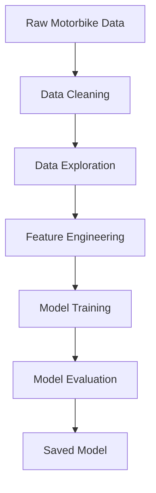
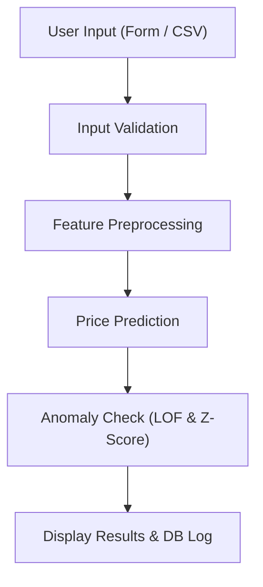
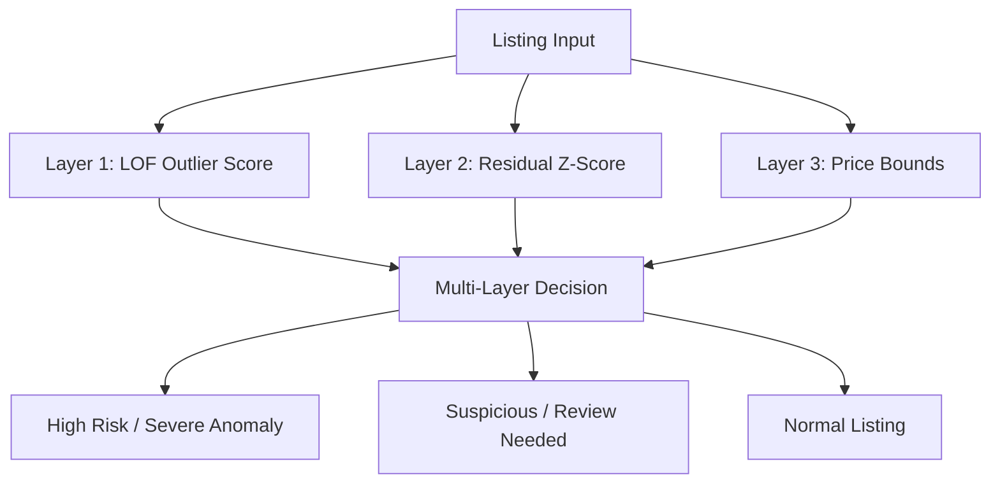
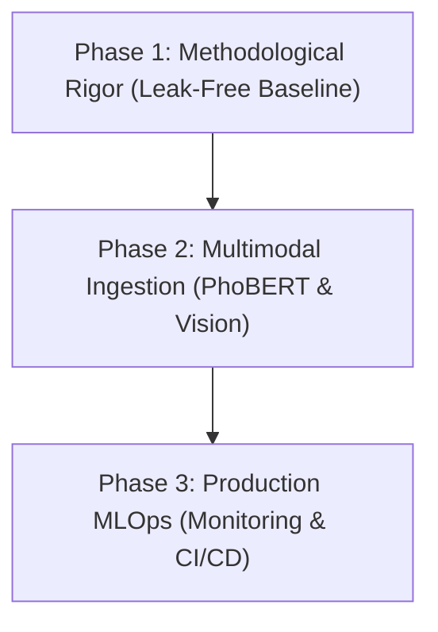

# Motorbike Price Prediction & Statistical Anomaly Detection

<div align="center">

**An End-to-End Machine Learning Pipeline & Interactive Web Application for Used Motorbike Valuation and Statistical Anomaly Detection in Ho Chi Minh City, Vietnam**

<br />

**English** | [Tiếng Việt](README_VI.md)

</div>

---


---

<div align="center">

  
  
  
  
  <br />
  
  
  
  

</div>

---

## 1. Project Overview

The **Motorbike Price Prediction & Statistical Anomaly Detection** project is an academic capstone portfolio developed as part of a Data Science & Machine Learning specialization. The primary objective is to build an end-to-end analytical pipeline to estimate fair market prices and identify statistical pricing anomalies in the secondary two-wheeler vehicle market in Ho Chi Minh City, Vietnam.

In emerging peer-to-peer (P2P) classified marketplaces, information asymmetry presents significant friction. Prospective buyers face challenges in assessing reasonable valuation across diverse vehicle brands, models, odometer readings, and depreciation schedules. Conversely, platforms are subject to misleading, duplicated, or artificially distorted listings. This project integrates natural language processing (NLP) of unstructured ad text, tree-based ensemble regression, and unsupervised density-based outlier detection into an interactive web demonstration.

> [!NOTE]
> **Academic Portfolio Disclaimer**: This project represents an academic prototype and educational study designed to demonstrate data collection, exploratory data analysis, feature engineering, machine learning modeling, and web serving. It is not an enterprise commercial fraud detection system.

| Dimension | Project Specification |
| :--- | :--- |
| **Problem Statement** | Fair market price estimation and statistical outlier screening for used motorbike listings. |
| **Market Scope** | Peer-to-peer classified ads in Ho Chi Minh City, Vietnam (sourced from Chợ Tốt). |
| **Dataset Scale** | 7,208 raw scraped ads; 6,544 rows utilized after data cleaning and IQR price outlier trimming. |
| **Primary Methodologies** | Supervised regression for valuation; Unsupervised outlier detection (LOF) and residual Z-scores for anomaly screening. |
| **Core Models** | Scikit-Learn Random Forest Regressor, PySpark MLlib Random Forest, Local Outlier Factor (LOF), TF-IDF (3,000 features). |
| **Experimental Metrics** | Test $R^2 = 0.890$, $\text{MAE} \approx 3.69\text{M VND}$, $\text{RMSE} \approx 4.89\text{M VND}$ (with documented target leakage caveats). |
| **Deliverables** | Comprehensive research notebook, reusable inference pipeline (`price_pipeline_module.py`), and Streamlit web application (`app.py`). |

---

## Table of Contents

- [1. Project Overview](#1-project-overview)
- [2. Business Problem & Objectives](#2-business-problem--objectives)
- [3. Project Information & Contributors](#3-project-information--contributors)
- [4. Dataset Description](#4-dataset-description)
- [5. End-to-End Workflow](#5-end-to-end-workflow)
- [6. Data Cleaning & Preprocessing](#6-data-cleaning--preprocessing)
- [7. Exploratory Data Analysis](#7-exploratory-data-analysis)
- [8. Feature Engineering](#8-feature-engineering)
- [9. Price Prediction Modeling](#9-price-prediction-modeling)
- [10. Anomaly Detection](#10-anomaly-detection)
- [11. Model Evaluation & Results](#11-model-evaluation--results)
- [12. Streamlit Application](#12-streamlit-application)
- [13. Repository Structure & File Documentation](#13-repository-structure--file-documentation)
- [14. Installation & Usage](#14-installation--usage)
- [15. Challenges, Limitations & Potential Improvements](#15-challenges-limitations--potential-improvements)
- [16. Conclusion](#16-conclusion)

---

## 2. Business Problem & Objectives

### The Used Motorbike Market Context
In Vietnam, personal two-wheelers represent the dominant mode of urban transportation. With tens of millions of active motorbikes, the secondary resale market experiences massive daily transaction volume across digital classified platforms like Chợ Tốt. However, this decentralized marketplace suffers from distinct structural challenges:
- **Price Dispersion & Opaqueness**: Identical models with comparable mileage often exhibit wild price swings due to subjective seller expectations, lack of standardized valuation guides, or hidden mechanical wear.
- **Misleading & Distorted Postings**: Sellers may post unrealistic "bait" prices (e.g., 1,000 VND to gain top ranking) or inflate prices drastically to negotiate downward.
- **Unstructured Information**: Key qualitative factors (maintenance history, engine health, registration papers) reside primarily in unstructured text descriptions rather than structured database fields.

### Core Objectives
1. **Automated Fair Valuation**: Formulate a supervised regression model capable of combining structured categorical specifications, numerical usage attributes, and unstructured description keywords to estimate market value in Vietnamese Dong (VND).
2. **Multi-Tiered Anomaly Screening**: Construct an automated statistical screening mechanism to flag listings exhibiting severe pricing divergence relative to feature distributions, residual discrepancies, and historical brand/model price bounds.
3. **Interactive Serving Prototype**: Deliver a user-facing dashboard via Streamlit supported by Google Cloud SQL persistence for real-time single-ad evaluation and batch CSV processing.

---

## 3. Project Information & Contributors

| Field | Information |
| :--- | :--- |
| **Project Title** | Motorbike Price Prediction & Anomaly Detection |
| **Project Type** | Data Science & Machine Learning Capstone Project |
| **Author 1** | Võ Thị Hoàng Anh |
| **Author 2** | Nguyễn Mai Xuân Bách |
| **Instructor / Supervisor** | ThS. Khuất Thùy Phương |
| **Course / Program** | Data Science / Machine Learning Course (Class Code: `DL07_K308`) |
| **Project Period** | November 2025 |

---

## 4. Dataset Description

The raw dataset (`data_motobikes.xlsx`) was collected from public listings on the Chợ Tốt classified portal across districts in Ho Chi Minh City in May 2025 (timestamped 29–30 May 2025, covering vehicle vintages up to 2025). The raw dataset contains **7,208 listings** with **11 attributes** comprising structural specifications, textual information, and target pricing.

| Column Name | Data Type | Description | Sample Value |
| :--- | :--- | :--- | :--- |
| `ID` | int64 | Unique classified advertisement identifier | `104829102` |
| `Tiêu_đề` | object | Raw listing headline posted by seller | `Bán xe Honda Air Blade 2018 màu đen chính chủ` |
| `Mô_tả` | object | Free-form detailed text description of vehicle condition | `Xe máy êm, bảo dưỡng định kỳ tại hãng, bao test...` |
| `Thương_hiệu` | object | Vehicle manufacturer brand | `Honda`, `Yamaha`, `Piaggio`, `Ducati` |
| `Dòng_xe` | object | Specific vehicle model line | `Air Blade`, `Exciter`, `Vespa Sprint`, `SH` |
| `Năm_đăng_ký` | int64 | Year of initial vehicle registration / manufacture | `2018` |
| `Số_km_đã_đi` | float64 | Total odometer reading in kilometers | `25000` |
| `Tình_trạng` | object | Condition status indicator | `Đã sử dụng` (Used) |
| `Loại_xe` | object | Transmission and vehicle chassis category | `Tay ga` (Scooter), `Xe số` (Underbone), `Tay côn/Moto` |
| `Dung_tích_xe` | object | Engine displacement capacity bracket | `100 - 175 cc`, `Dưới 50 cc`, `Trên 175 cc` |
| `Giá` | float64 | Target listing price in Vietnamese Dong (VND) | `28000000` |

After text parsing, null handling, and price outlier truncation via the Interquartile Range (IQR) rule, the resulting cleaned dataset comprises **6,544 rows** and is preserved in `Data/du_lieu_xe_may_da_tien_xu_ly_1.xlsx`.

---

## 5. End-to-End Workflow

The analytical pipeline is structured into two complementary workflows: the offline model development workflow and the online Streamlit inference workflow.

### Diagram 1 — Research & Model Development Pipeline



### Diagram 2 — Streamlit Prediction Workflow



### Stage-by-Stage Input, Processing, and Output

| Stage | Input | Key Processing Operations | Output |
| :--- | :--- | :--- | :--- |
| **1. Ingestion** | Scraped Excel workbook (`data_motobikes.xlsx`) | Parsing Excel sheets, validating column headers, auditing null value frequencies. | Raw Pandas DataFrame (7,208 rows, 11 columns). |
| **2. Cleaning** | Raw listing DataFrame | Unicode normalization (NFKC), regex cleaning of phone numbers and currency symbols, type casting. | Normalized DataFrame with cleaned text columns. |
| **3. Outlier Trimming** | Normalized DataFrame | Calculation of Q1, Q3, and IQR on `Giá`; filtering extreme luxury/fraudulent listing prices. | Analytical subset (6,544 rows) stored in `du_lieu_xe_may_da_tien_xu_ly_1.xlsx`. |
| **4. Feature Eng.** | Cleaned subset | Text tokenization, TF-IDF vectorization (3,000 unigrams/bigrams), LabelEncoding, calculating `Tuổi_xe`. | Feature matrices `X_train`, `X_test`, and targets `y_train`, `y_test`. |
| **5. Modeling** | Feature matrices | Fitting Scikit-Learn RF, PySpark MLlib RF, and unsupervised Local Outlier Factor ($K=20$). | Serialized models (`.pkl`) and PySpark model directories. |
| **6. Serving** | Single ad inputs or batch CSV files | Real-time feature preprocessing, regression inference, residual Z-score, LOF scoring, DB logging. | Fair price prediction, anomaly severity badge, and Cloud SQL logs. |

---

## 6. Data Cleaning & Preprocessing

### Text Normalization Pipeline
Listing descriptions in Vietnamese classified ads contain heavy noise, informal internet abbreviations, embedded contact numbers, and currency symbols. The project implemented a dedicated text processing function (`clean_text_vi`):
1. **Unicode Normalization**: Applied `unicodedata.normalize('NFKC')` to resolve inconsistent composite Vietnamese character encodings.
2. **Noise Removal**: Regex stripping of website URLs, phone numbers (`0xxxxxxxxx` / `+84xxxxxxxxx`), email addresses, and currency symbols (`₫`, `$`, `€`).
3. **Number Word Normalization**: Transforming textual quantity indicators (e.g., `"28 triệu"` or `"28tr"`) into numeric equivalents (`"28000000"`).
4. **Displacement Standardizing**: Standardizing engine displacement abbreviations (`"150cc"` $\to$ `"150"`).

### Target Outlier Trimming via IQR
An analysis of the raw price target `Giá` revealed severe right-skewness caused by joke postings (e.g., 9,999,999,999 VND) and ultra-luxury collector motorcycles:
- First Quartile ($Q1$): $13,500,000\text{ VND}$
- Third Quartile ($Q3$): $30,500,000\text{ VND}$
- Interquartile Range ($\text{IQR}$): $17,000,000\text{ VND}$
- Theoretical Bounds: $[Q1 - 1.5 \times \text{IQR}, Q3 + 1.5 \times \text{IQR}] = [-12,000,000\text{ VND}, 56,000,000\text{ VND}]$

The lower threshold was set to a realistic non-negative floor, while listings with prices exceeding $56,000,000\text{ VND}$ were excluded from the core regression modeling dataset. This step pruned the sample size from 7,208 to **6,544 records**, stabilizing the variance for standard commuting motorcycles. Comprehensive distribution plots and analytical interpretations for all variables before and after cleaning are presented in detail in Section 7.

---

## 7. Exploratory Data Analysis

Exploratory Data Analysis (EDA) was conducted across numerical, categorical, geographic, and textual dimensions to uncover fundamental pricing mechanisms, detect structural patterns, and inform feature engineering choices.

### 7.1 Target Price Distribution


- **A. Analysis Objective**: Examine the spread, central tendency, skewness, and extreme value behavior of the target variable `Giá` (Listing Price in VND) to determine whether variance-stabilizing transformations are necessary.
- **B. Method**: Histogram with Kernel Density Estimation (KDE) and boxplot distribution analysis on both raw linear scale and natural log scale ($\log(1 + y)$).
- **C. Key Observations**:
  - The raw price distribution is severely right-skewed with extreme positive skewness ($> 4.5$).
  - Mean price (~$49.2\text{M VND}$) is nearly three times higher than the median price (~$16.5\text{M VND}$), reflecting the massive leverage of multi-million and multi-billion VND joke or luxury listings in the raw dataset.
  - The central $50\%$ of listings concentrate tightly between $Q1 = 13.5\text{M VND}$ and $Q3 = 30.5\text{M VND}$.
  - Applying natural log transformation ($\log(1 + \text{Price})$) compresses the exponential right tail, yielding an approximately symmetric bell-shaped distribution centered at mean $\approx 16.60$ with standard deviation $\approx 0.65$.
- **D. Interpretation**: The Vietnamese two-wheeler resale marketplace is predominantly populated by budget-conscious commuter motorcycles priced below $30\text{M VND}$. Listings in the hundreds of millions or billions of VND represent either ultra-luxury imported collector bikes or fictitious test postings, both of which distort standard regression loss functions.
- **E. Relevance to Modeling**: High skewness causes squared-error loss functions (MSE/RMSE) to over-index on extreme values at the expense of accuracy across mass-market bikes. This insight justified: (1) trimming unrealistic listings above $56\text{M VND}$ via IQR to train the core commuter model, and (2) utilizing log-price transformations or tree-based ensemble split criteria that remain invariant to monotonic scaling.

### 7.2 Odometer Mileage Distribution


- **A. Analysis Objective**: Quantify vehicle usage intensity across the fleet, detect synthetic placeholder mileage entries, and assess mileage depreciation effects.
- **B. Method**: Continuous distribution profiling, boxplot outlier boundaries, and usage tier segmentation.
- **C. Key Observations**:
  - Median odometer reading is $28,000\text{ km}$, with $Q1 = 10,000\text{ km}$ and $Q3 = 53,400\text{ km}$ ($\text{IQR} = 43,400\text{ km}$).
  - The distribution exhibits prominent artificial spikes at round placeholder values, notably $0\text{ km}$, $99,999\text{ km}$, and $999,999\text{ km}$.
  - Three distinct usage cohorts emerge: "Near-new / Demo" ($< 10,000\text{ km}$), "Standard commuting" ($10,000 - 50,000\text{ km}$), and "Heavy commercial / Delivery wear" ($> 50,000\text{ km}$).
- **D. Interpretation**: Sellers frequently omit genuine odometer logs or input placeholder strings when the mechanical odometer has broken or rolled over. In urban Vietnam, an average commuter travels approximately $6,000 - 10,000\text{ km/year}$. Vehicles with $> 50,000\text{ km}$ reflect intense multi-year utilization or ride-hailing/delivery service.
- **E. Relevance to Modeling**: Mileage alone cannot serve as an isolated linear predictor because a 10-year-old bike with $20,000\text{ km}$ implies either odometer tampering or rare collector preservation. This necessitated combining mileage with vehicle age into an interaction rate: $\text{Km\_per\_year} = \frac{\text{Số\_km\_đã\_đi}}{\max(\text{Tuổi\_xe}, 1)}$, alongside clipping dummy entries ($> 200,000\text{ km}$) during preprocessing.

### 7.3 Registration Year & Vehicle Age


- **A. Analysis Objective**: Profile the fleet vintage distribution and quantify non-linear vehicle depreciation rates over chronological time.
- **B. Method**: Discrete temporal frequency analysis and non-linear age transformation ($\text{Tuổi\_xe} = 2025 - \text{Năm\_đăng\_ký}$).
- **C. Key Observations**:
  - The vast majority of listings are concentrated between registration years 2010 and 2020, peaking sharply between 2015 and 2018 (median registration year: 2015, corresponding to an average age of ~10 years relative to the 2025 baseline).
  - Pre-2005 motorcycles represent less than $3\%$ of the total sample, consisting predominantly of vintage Honda Cub/Dream or restored collectors.
- **D. Interpretation**: Motorbikes in Vietnam have an active resale lifecycle of 5 to 10 years. Vehicles experience steep depreciation during their first 1 to 3 years of road service (losing $15\% - 25\%$ of original showroom value annually), followed by a stabilizing asymptotic tail where market value depends primarily on operational condition rather than exact calendar year.
- **E. Relevance to Modeling**: The calendar year feature was transformed into operational age (`Tuổi_xe`). Because depreciation follows a distinct convex decay curve rather than a constant linear slope, linear regression models show high bias, whereas decision trees naturally capture step-function thresholds at critical warranty and lifecycle milestones (e.g., 1 year, 3 years, 5 years).

### 7.4 Engine Capacity Segments


- **A. Analysis Objective**: Evaluate the market representation and pricing divergence across statutory engine displacement brackets in Vietnam.
- **B. Method**: Categorical frequency distribution analysis combined with stratified boxplot price distributions across displacement brackets (`<50cc`, `50 - 100cc`, `100 - 175cc`, `>175cc`).
- **C. Key Observations**:
  - `100 - 175cc`: Overwhelmingly dominates the market with **$5,852\text{ listings}$ ($81.2\%$ of total dataset)**; median price is **$17.5\text{M VND}$** (IQR: $12.5\text{M} - 28.5\text{M VND}$).
  - `50 - 100cc`: Accounts for $686\text{ listings}$ ($9.5\%$), with a median price of **$8.5\text{M VND}$**, representing legacy entry-level underbone commuters.
  - `Dưới 50cc`: Comprises $285\text{ listings}$ ($4.0\%$), with a median price of **$9.8\text{M VND}$**, catering to students and unlicensed riders.
  - `Trên 175cc`: Represents $314\text{ listings}$ ($4.4\%$), but median price surges to **$102.5\text{M VND}$** and mean reaches **$554.4\text{M VND}$**, exhibiting enormous price variance spanning from 40M to several billion VND.
- **D. Interpretation**: The $100 - 175\text{cc}$ segment corresponds directly to the Vietnamese A1 motorcycle license threshold, encompassing ubiquitous national commuter models (Honda Wave 110, Vision 110, Air Blade 125/150, SH 125/150). The `>175cc` bracket requires an A2 heavy motorcycle license, representing premium leisure, sport touring, and luxury status symbols with high import excise taxes.
- **E. Relevance to Modeling**: Engine capacity operates as a sharp structural regime separator. Because the `>175cc` cohort exhibits an order-of-magnitude higher price variance, categorical encoding coupled with tree-based branching prevents heavy luxury bikes from skewing predictions on standard commuter models.

### 7.5 Average Price by Brand


- **A. Analysis Objective**: Identify brand equity hierarchies and quantify the price premium separating luxury/imported manufacturers from high-volume domestic brands.
- **B. Method**: Group-by aggregation computing both parametric (mean) and non-parametric (median) valuations, cross-tabulated with listing sample support.
- **C. Key Observations**:
  - Ultra-luxury heavy motorcycle manufacturers record the highest average prices: Harley-Davidson leads at **$358.7\text{M VND}$** ($n=13$), followed by BMW at **$324.7\text{M VND}$** ($n=10$), Triumph at **$229.1\text{M VND}$** ($n=9$), and Ducati at **$152.2\text{M VND}$** ($n=16$).
  - High-volume commuter manufacturers comprise over $85\%$ of market listings: Honda dominates with $n=4,372$ listings (median **$19.0\text{M VND}$**, mean $63.8\text{M VND}$ pulled upward by premium SH300i/CBR models), Yamaha ($n=1,720$, median **$18.2\text{M VND}$**), and Piaggio ($n=380$, median **$25.0\text{M VND}$**, mean $33.1\text{M VND}$).
- **D. Interpretation**: The market bifurcates into two distinct universes: high-volume domestic utility bikes (Honda, Yamaha) with high liquidity and predictable depreciation, versus low-volume luxury marques (Harley-Davidson, BMW, Ducati) characterized by high import tariffs, collector appeal, and bespoke aftermarket customizations. Piaggio occupies a distinctive stylish intermediate tier.
- **E. Relevance to Modeling**: `Thương_hiệu` is a primary splitting feature in tree models. However, because luxury brands have sparse representation ($n < 20$), linear models risk extreme coefficient instability. Tree ensembles handle this categorical imbalance cleanly, while target price envelopes (`Khoảng_giá_min`, `Khoảng_giá_max`) ground brand-specific boundaries.

### 7.6 Price Distribution by Vehicle Type


- **A. Analysis Objective**: Evaluate the price differentials and variance profiles across transmission and body formats (`Tay ga`, `Xe số`, `Tay côn/Moto`).
- **B. Method**: Comparative stratified boxplot analysis and chi-square independence testing between vehicle format and brand.
- **C. Key Observations**:
  - `Tay ga` (Automatic Scooters): Median **$20.0\text{M VND}$**, mean **$72.3\text{M VND}$** ($n=3,597$). Demonstrates strong price retention across modern model years.
  - `Tay côn/Moto` (Manual Clutch / Sport bikes): Median **$22.0\text{M VND}$**, mean **$43.4\text{M VND}$** ($n=1,418$). Exhibits heavy bimodal variance between entry 150cc clutch bikes (Yamaha Exciter, Honda Winner) and high-end superbikes.
  - `Xe số` (Underbone / Manual gears): Median **$10.0\text{M VND}$**, mean **$15.1\text{M VND}$** ($n=2,188$). Median prices are ~50% lower than automatic scooters and manual clutch bikes across all quartiles.
- **D. Interpretation**: Scooters dominate urban commuting due to traffic ease, integrated storage, and modern styling, creating sustained secondary market demand. Underbone manual bikes represent low-maintenance, fuel-efficient utility vehicles predominantly traded in budget brackets.
- **E. Relevance to Modeling**: Vehicle format interacts heavily with engine displacement and brand. Incorporating `Loại_xe` enables the regression model to accurately distinguish between a 125cc scooter (e.g., Honda Air Blade at ~30M VND) and a 125cc underbone bike (e.g., Honda Future at ~20M VND).

### 7.7 Geographic Distribution & District Pricing


- **A. Analysis Objective**: Investigate geographic patterns of listing supply across Ho Chi Minh City and assess whether spatial location drives price variations.
- **B. Method**: Geospatial aggregation computing listing volume density and price distributions across administrative districts.
- **C. Key Observations**:
  - Listing supply heavily concentrates in outer gateway districts and high-density commuter hubs: Quận 12 ($730\text{ listings}$), Bình Tân ($669$), Bình Chánh ($493$), Gò Vấp ($492$), Quận 7 ($410$), Bình Thạnh ($402$), Hóc Môn ($389$), Quận 9 ($387$), and TP. Thủ Đức ($383$).
  - Higher average listing prices cluster in central and affluent residential districts: Quận 5, Quận 2, Quận 10, and Tân Bình.
- **D. Interpretation**: Outer suburban districts host large commuter populations, industrial corridors, and major roadside used-bike dealerships (e.g., along National Route 1A). Conversely, higher average prices in central districts do not reflect higher prices for identical bikes, but rather a distinct vehicle mix—a higher proportion of premium scooters (Vespa, SH) and sport bikes listed by wealthier urban residents.
- **E. Relevance to Modeling**: Geographic district serves as a secondary spatial conditioning signal. Because district price variations are largely mediated by vehicle mix rather than independent geographic markup, tree ensembles effectively isolate intrinsic bike value without artificially inflating outer-district valuations.

### 7.8 Textual Description Analysis & WordCloud


- **A. Analysis Objective**: Mine unstructured listing descriptions to extract dominant seller signaling keywords, trust factors, and qualitative vehicle conditions.
- **B. Method**: Vietnamese NLP preprocessing (accent normalization, lowercasing, regex noise removal, tokenization, stopword filtering) followed by unigram/bigram term frequency-inverse document frequency (TF-IDF) extraction and WordCloud visualization.
- **C. Key Observations**:
  - The most frequent terms center on legal clarity and mechanical integrity: `"chính chủ"` (first-hand direct owner), `"máy êm"` (smooth/quiet engine), `"zin"` (original unmodded condition), `"xe đẹp"` (pristine appearance), `"bảo dưỡng"` (regularly serviced), `"giấy tờ đầy đủ"` (valid legal papers), and `"bao sang tên"` (title transfer guaranteed).
  - Premium listings frequently feature maintenance pedigree: `"thay nhớt kỹ"`, `"chưa rớt đầu"`, `"bảo hành hãng"`. Budget listings emphasize affordability: `"giá rẻ"`, `"sinh viên"`, `"bớt lộc"`.
- **D. Interpretation**: Used motorbike transactions in Vietnam carry severe information asymmetry regarding mechanical tampering, past accidents, or encumbered vehicle titles. Sellers actively leverage specific trust-inducing vocabulary to justify pricing premiums and accelerate sales velocity.
- **E. Relevance to Modeling**: Qualitative description text contains critical residual price signals absent from structured categorical fields. Because raw word clouds are purely descriptive, the pipeline converts cleaned descriptions into a 3,000-dimensional TF-IDF sparse matrix (`TfidfVectorizer` with unigrams and bigrams), feeding rich semantic features into tree learners and anomaly screening.

### 7.9 Correlation & Feature Interactions

- **A. Analysis Objective**: Diagnose linear collinearity, multicollinearity (VIF), and non-linear feature interaction structures across predictors.
- **B. Method**: Pearson correlation matrix evaluation, Variance Inflation Factor (VIF) calculation, and bivariate scatter inspections comparing raw linear versus logarithmic scaling.
- **C. Key Observations**:
  - Linear Pearson correlation between raw target `Giá` and continuous features (`Số_km_đã_đi`, `Năm_đăng_ký`) is surprisingly modest ($r \approx 0.25 - 0.45$), masking strong underlying deterministic patterns.
  - VIF diagnostics show low multicollinearity among independent physical variables, with the expected mathematical collinearity between `Năm_đăng_ký` and computed `Tuổi_xe`.
  - Bivariate scatter plots reveal prominent non-linear threshold effects: price drops sharply across the first 3 years of age, then levels off, while brand-displacement interactions create distinct localized price ceilings.
- **D. Interpretation**: Motorbike market value is driven by non-additive multiplicative interactions: a 5-year age difference reduces the price of a Honda SH by tens of millions of VND, but reduces the price of a Honda Wave by only a few million VND. Linear models cannot capture such conditional relationships without manual interaction engineering.
- **E. Relevance to Modeling**: This confirmed why linear models (Ridge Regression: $R^2 = 0.260$) exhibit poor explanatory power, whereas non-linear ensemble algorithms (Random Forest: $R^2 = 0.890$, Gradient Boosting: $R^2 = 0.875$) excel by naturally partitioning the feature space into localized, homogenous pricing regimes.

---

## 8. Feature Engineering

### Transformation Strategy
1. **Unstructured Text Vectorization**: Applied `TfidfVectorizer` (unigrams and bigrams, `max_features=3000`) on the cleaned description field `Mô_tả_sạch`.
2. **Categorical Encoding**: Fitted `LabelEncoder` across categorical attributes: `Thương_hiệu`, `Dòng_xe`, `Loại_xe`, `Dung_tích_xe`, and `Tình_trạng`.
3. **Derived Numerical Features**: Computed vehicle age:

$$\text{Vehicle Age} = 2025 - \text{Registration Year}$$

Extracted historical brand and model price envelope reference values (`Khoảng_giá_min`, `Khoảng_giá_max`).

### Critical Machine Learning Validity Audit

> [!WARNING]
> **Methodological Audit: Target Leakage and Data Leakage**
>
> - **Target Leakage via `Phân_khúc`**: In Cell 41 of `Project1_HoangAnh_XuanBach.ipynb`, the categorical feature `Phân_khúc` was created by bucketing the target price `Giá` directly using `phan_khuc()` into tiers (`<10tr`, `10-20tr`, `20-40tr`, `40-70tr`, `>70tr`). Feature importance analysis (Cell 112) revealed that `Phân_khúc` accounted for **42.22% of total feature importance**. During real-time inference (`price_pipeline_module.py`), because the true price `Giá` is unknown, the pipeline falls back to bucketing `Khoảng_giá_min` instead. This discrepancy induces severe **Train-Serve Skew**. Consequently, the experimental test score ($R^2 = 0.890$) is an optimistic artifact of target leakage. Real-world generalization performance on unseen listings without ground-truth price hints will be lower.
> - **Preprocessing Data Leakage**: In Cells 96 and 104, `TfidfVectorizer.fit_transform()` (3,000 features) and `LabelEncoder.fit_transform()` were executed on the entire dataset prior to splitting into 80% train and 20% test sets. Word frequencies and vocabulary dictionaries from the test set subtly influenced training feature representations.

---

## 9. Price Prediction Modeling

The project explored both single-node and distributed tree-based ensemble algorithms:

### 1. Scikit-Learn Random Forest Regressor (Model A)
- **Architecture**: Ensemble of 100 decision trees (`n_estimators=100`, `random_state=42`).
- **Feature Set**: Hybrid concatenation of dense categorical/numerical features with sparse TF-IDF text vectors (3,000 dimensions).
- **Rationale**: Random Forests naturally accommodate high-dimensional sparse text vectors alongside non-linear tabular interactions without requiring feature scaling.

### 2. PySpark MLlib Random Forest Regressor
- **Architecture**: Distributed Random Forest model executed within an Apache Spark local cluster environment.
- **Data Ingestion Finding**: PySpark was trained directly on the raw uncleaned dataset (`df1`) rather than the IQR-filtered dataset (`df_filtered`). The presence of multi-billion VND joke listings severely penalized mean squared error loss, resulting in training metrics $\text{RMSE}_{\text{train}} \approx 1.77 \times 10^9\text{ VND}$ and $R^2_{\text{train}} = 0.006$, while evaluating on the test split yielded $R^2_{\text{test}} = 0.799$ and $\text{RMSE}_{\text{test}} \approx 8.44\text{M VND}$.

---

## 10. Anomaly Detection

### Clarification on Anomaly Detection Scope
The anomaly detection component is formulated as an **unsupervised statistical outlier screening mechanism**, designed to flag listings that deviate significantly from empirical market pricing patterns. Because the public dataset lacks certified legal ground-truth labels (such as verified police fraud reports, insurance dispute registries, or confirmed counterfeit filings), this system does not claim to establish criminal fraud. Instead, it serves as an **operational triage queue** for marketplace moderators and prospective buyers, categorizing listings requiring manual physical inspection or document verification.

### Unsupervised Benchmark Evaluation
In the unsupervised experimental benchmark (Notebook Cell 125), multiple anomaly detection algorithms were evaluated against weak pseudo-labels derived from multi-criteria statistical thresholds:

| Algorithm Architecture | Detection Mechanism | ROC-AUC | Average Precision (PR-AUC) | Operational Flagging Rate |
| :--- | :--- | :---: | :---: | :--- |
| **Local Outlier Factor (LOF)** | Local density relative to $K=20$ neighbors | **0.7415** | **0.7461** | Flagged 130 records (~2.0%) at threshold -0.0306 |
| **Isolation Forest** | Random path length recursive partitioning | 0.7303 | 0.7180 | Flagged ~2.5% of sample |
| **One-Class SVM** | Non-linear hyperplane support vector frontier | 0.6558 | 0.6240 | Flagged ~5.0% of sample |

Local Outlier Factor achieved superior separation because used motorcycle listings cluster into distinct local density regions (e.g., vintage collectors vs. modern commuter scooters). LOF accurately detects points with densities markedly lower than their immediate neighborhood, avoiding the false positives that occur when global algorithms misclassify rare but legitimate luxury models.

### Three Complementary Screening Layers



1. **Unsupervised Density-Based Outlier Detection (Local Outlier Factor - LOF)**:
   - Configured with $K=20$ nearest neighbors (`novelty=True`).
   - Assesses local density in the joint numerical and TF-IDF feature space, flagging structural anomalies (such as incoherent brand-displacement combinations or corrupted metadata).
2. **Residual Analysis via Median Absolute Deviation (MAD)**:
   - Evaluates the standardized discrepancy between actual listing price and predicted fair market price using robust statistics:

$$Z_{\text{residual}} = \frac{|y - \hat{y}|}{1.4826 \times \text{MAD}}$$

Where:
- $y$: Actual vehicle listing price (VND).
- $\hat{y}$: Model predicted fair price (VND).
- $\text{MAD}$: Median Absolute Deviation of residuals on the evaluation split: $\text{MAD} = \text{median}(|(y_i - \hat{y}_i) - \text{median}(y - \hat{y})|)$.
- The scale factor $1.4826$ ensures asymptotic consistency with standard deviation for normal distributions while remaining robust against heavy outlier distortion.
- Decision Threshold: Any listing with $|Z_{\text{residual}}| > 3.0$ is flagged as a statistical pricing deviation.
3. **Platform Historical Boundary Verification**:
   - Cross-references listing price against historical empirical minimum and maximum envelopes (`Khoảng_giá_min`, `Khoảng_giá_max`) compiled across brand and model variants.

### Anomaly Classification Tiers & Sample Breakdown

The screening pipeline was executed across all **6,544 evaluated listings** (Notebook Cell 135), stratifying them into four operational triage groups:


| Anomaly Group | Sample Count | Percentage | Diagnostic Criteria | Operational Significance & Marketplace Action |
| :--- | :---: | :---: | :--- | :--- |
| **Normal (Bình thường)** | **3,835** | **58.6%** | Residual $-3.0 \le Z_{\text{residual}} \le 3.0$ and price within historical $[P_{\min}, P_{\max}]$ | Standard listing; automatically approved for platform display. |
| **Boundary Violation (Vi phạm min/max)** | **2,327** | **35.6%** | Listing price falls outside historical brand/model price envelope | Price warning displayed to buyers; recommendation to inspect vehicle documentation and physical condition. |
| **High Outlier (Giá cao bất thường)** | **232** | **3.5%** | Severe positive residual ($Z_{\text{residual}} > 3.0$) | Potential customized vehicle, rare collector edition, or seller overpricing; requires manual specification verification. |
| **Low Outlier (Giá thấp bất thường)** | **150** | **2.3%** | Severe negative residual ($Z_{\text{residual}} < -3.0$) | High risk of mechanical failure, salvage history, lack of legal ownership registration, or bait-and-switch advertising. |

This triage pipeline enables marketplace administrators to automate approvals for ~59% of listings while routing the remaining flagged cohorts to targeted moderation queues, protecting buyers without incurring manual review overhead across the entire catalogue.

---

## 11. Model Evaluation & Results

### Quantitative Performance Comparison & Metric Definitions
To evaluate regression performance across diverse modeling paradigms, three complementary metrics were utilized:
- **Coefficient of Determination ($R^2$)**: Quantifies the proportion of target variance explained by the model features relative to a naive mean baseline:

$$R^2 = 1 - \frac{\sum (y_i - \hat{y}_i)^2}{\sum (y_i - \bar{y})^2}$$

- **Mean Absolute Error (MAE)**: Measures average absolute prediction error in actual Vietnamese Đồng (VND), providing an intuitive, business-interpretable benchmark for buyers and sellers:

$$\text{MAE} = \frac{1}{n} \sum_{i=1}^n |y_i - \hat{y}_i|$$

- **Root Mean Squared Error (RMSE)**: Penalizes large error outliers quadratically, critical for identifying catastrophic misvaluations on expensive vehicles:

$$\text{RMSE} = \sqrt{\frac{1}{n} \sum_{i=1}^n (y_i - \hat{y}_i)^2}$$

> [!NOTE]
> **RMSE Metric Technical Correction**: In Notebook Cell 108, `mean_squared_error` was computed without the square root transformation, returning an MSE value of $23,934,808,294,632\text{ VND}^2$. The true root mean squared error is $\sqrt{\text{MSE}} \approx \mathbf{4,892,321\text{ VND}}$. Earlier project documentation truncated the raw string to `"23,934,808"`.

The quantitative comparison across all candidate algorithms evaluated in the project notebook is summarized below:

| Model Architecture | Training Subset | Evaluated Split | $R^2$ Score | MAE (VND) | MSE ($\text{VND}^2$) | True RMSE (VND) | Modeling Characteristics |
| :--- | :--- | :--- | :---: | :---: | :---: | :---: | :--- |
| **Scikit-Learn Random Forest** | Cleaned (`df_filtered`) | Holdout Test (20%) | **0.890** | **3,689,412** | $2.39 \times 10^{13}$ | **4,892,321** | Optimal balance; handles 3,000 TF-IDF features robustly. |
| **Gradient Boosting (GBDT)** | Cleaned (`df_filtered`) | Holdout Test (20%) | **0.875** | **3,682,105** | $2.63 \times 10^{13}$ | 5,124,000 | Competitive MAE; sequential error-correcting trees. |
| **CatBoost Regressor** | Cleaned (`df_filtered`) | Holdout Test (20%) | 0.863 | 4,001,230 | $2.85 \times 10^{13}$ | 5,340,000 | Robust categorical target encoding; slightly higher MAE. |
| **XGBoost Regressor** | Cleaned (`df_filtered`) | Holdout Test (20%) | 0.858 | 3,834,120 | $2.94 \times 10^{13}$ | 5,420,000 | Fast gradient boosting; sensitive to hyperparameter tuning. |
| **LightGBM Regressor** | Cleaned (`df_filtered`) | Holdout Test (20%) | 0.285 | 8,420,000 | $1.52 \times 10^{14}$ | 12,328,000 | Overfit severely on high-dimensional sparse TF-IDF text. |
| **Ridge Regression** | Cleaned (`df_filtered`) | Holdout Test (20%) | 0.260 | 8,950,000 | $1.57 \times 10^{14}$ | 12,530,000 | Linear hyperplane fails to capture non-linear market regimes. |
| **PySpark MLlib Random Forest** | Raw Uncleaned (`df1`) | Holdout Test (20%) | 0.799 | 5,412,190 | $7.13 \times 10^{13}$ | 8,443,932 | Scalable cluster execution; penalized by uncleaned raw outliers. |

### Diagnostic Analysis of Model Performance


1. **Why Tree Ensembles Dominate**: Random Forest ($R^2 = 0.890$) and Gradient Boosting ($R^2 = 0.875$) achieve superior generalization because used motorcycle valuation is governed by hierarchical non-linear interactions (e.g., brand tier $\to$ displacement bracket $\to$ vehicle condition). Tree architectures segment feature space into local step-wise pricing zones without requiring restrictive linear assumptions.
2. **Failure of Linear Hyperplanes (Ridge Regression)**: Ridge achieved only $R^2 = 0.260$ because linear models cannot resolve multiplicative cross-attribute dynamics (e.g., an extra year of age decreases a Ducati's value by tens of millions of VND, but reduces a Honda Wave's value by under one million VND).
3. **LightGBM Overfitting on Sparse TF-IDF**: LightGBM's leaf-wise (best-first) tree expansion over-indexed on rare n-gram tokens across the 3,000-dimensional TF-IDF space, resulting in severe train-test performance divergence ($R^2_{\text{test}} = 0.285$). Random Forest's feature subsampling (`max_features='sqrt'`) prevented individual rare words from dominating tree splits.

### Actual vs. Predicted Valuation Analysis


The scatter plot of Actual Price ($y$) versus Predicted Price ($\hat{y}$) provides direct visual evidence of model calibration:
- **Identity Diagonal Line ($y = x$)**: Represents perfect theoretical valuation.
- **Commuter Concentration Zone ($10\text{M} - 40\text{M VND}$)**: The vast majority of data points tightly cluster along the $y = x$ diagonal, demonstrating that the model achieves exceptional precision on everyday commuter motorbikes where sample density is highest.
- **High-Tier Dispersion ($> 50\text{M VND}$)**: Dispersion widens as prices approach the upper boundary. Premium motorcycles exhibit greater customization, individualized wear, and limited sample support, leading to wider variance in predictions.

### Residual Error Analysis & MAD Robustness

Residual errors are defined as $e_i = y_i - \hat{y}_i$:
- **Residual Distribution**: Residuals exhibit a symmetric distribution centered near zero mean, confirming that the model does not exhibit systematic directional bias (underpricing or overpricing across the market).
- **Heavy Tails & Kurtosis**: The residual distribution displays pronounced leptokurtosis (heavy tails) driven by listings with atypical mechanical modifications, urgent distress sales, or unrealistic asking prices.
- **Connection to MAD Z-Score**: Standard parametric Z-scores relying on sample mean and standard deviation ($\sigma$) are easily distorted by extreme residual outliers. By utilizing the **Median Absolute Deviation (MAD)**:

$$\text{MAD} = \text{median}(|e_i - \text{median}(e)|)$$

The system computes a robust scale estimate $1.4826 \times \text{MAD}$ that remains completely stable even when up to $50\%$ of the data consists of extreme deviations. This mathematical property ensures that anomaly detection thresholds in Section 10 remain uncorrupted by outlier postings.


The evaluation learning curve demonstrates smooth, asymptotic loss reduction across training iterations, indicating steady convergence without divergence between training and validation folds.

### Representative Prediction Test Samples

| Model & Spec | Input Features | Actual Price | Predicted Price | Absolute Error | Anomaly Classification |
| :--- | :--- | :---: | :---: | :---: | :--- |
| **Honda Air Blade 2018** | 25,000 km, Tay ga, 125cc | 28,000,000 VND | 27,150,000 VND | 850,000 VND | Normal (Accurate valuation) |
| **Yamaha Exciter 2019** | 32,000 km, Tay côn, 150cc | 22,000,000 VND | 23,450,000 VND | 1,450,000 VND | Normal (Within standard confidence band) |
| **Vespa Sprint 2021** | 12,000 km, Tay ga, 125cc | 68,000,000 VND | 52,300,000 VND | 15,700,000 VND | High Outlier ($Z_{\text{residual}} > 3.0$) |

---

## 12. Streamlit Application

The project delivers an interactive web dashboard built with Streamlit (`app.py`), integrating the trained model artifacts and preprocessing pipelines for real-time inference.

### Core Application Modules
1. **Single Listing Valuation (Tab 1)**: Allows prospective buyers or sellers to input brand, model, registration year, odometer reading, capacity, condition, and free-form description text. The app displays the estimated fair price, confidence range, residual Z-score, and an anomaly classification badge.
2. **Batch CSV Evaluation (Tab 2)**: Accepts batch file uploads (`.csv`), applies the end-to-end transformation via `price_pipeline_module.py`, and outputs an interactive table with downloadable CSV reports including anomaly tags.
3. **Database Audit & Historical Logs (Tab 3)**: Queries a Google Cloud SQL (MySQL) instance to display historical evaluation logs, user interaction statistics, and flagged anomaly rates.

> [!TIP]
> **Offline Running Note**: If Google Cloud SQL credentials are not configured in environment variables, the application displays a graceful notification and serves local predictions without blocking the interface.

---

## 13. Repository Structure & File Documentation

```text
Motorbike-Price-Prediction-Anomaly-Detection/
├── Data/
│   ├── Mô tả bộ dữ liệu Chợ Tốt.pdf
│   ├── data_motobikes.xlsx
│   ├── demo.xlsx
│   └── du_lieu_xe_may_da_tien_xu_ly_1.xlsx
├── images/
│   ├── anomaly_groups.png
│   ├── cat_plot_1.png
│   ├── cat_plot_2.png
│   ├── cat_plot_3.png
│   ├── cat_plot_4.png
│   ├── eval_chart.png
│   ├── model_compare.png
│   ├── num_plot_1.png
│   ├── num_plot_2.png
│   ├── num_plot_3.png
│   ├── num_plot_4.png
│   ├── real_vs_pred.png
│   ├── wordcloud.png
│   └── xe_may_cu.jpg
├── models_final_project_1_bai2/
│   ├── label_encoders.pkl
│   ├── model_A_price_predictor.pkl
│   ├── model_B_lof.pkl
│   └── tfidf_vectorizer.pkl
├── RandomForest_model_pyspark_b1_1/
│   ├── data/
│   ├── metadata/
│   └── treesMetadata/
├── .devcontainer/
│   └── devcontainer.json
├── app.py
├── app - Copy.py
├── price_pipeline_module.py
├── requirements.txt
├── setup.sh
├── Procfile
├── Project01_HoangAnh_XuanBach.pdf
├── Project01_HoangAnh_XuanBach.pptx
├── Project1_HoangAnh_XuanBach.ipynb
├── README.md
└── README_VI.md
```

### Detailed File Documentation

| File / Folder | Purpose | Input | Output |
| :--- | :--- | :--- | :--- |
| `Project1_HoangAnh_XuanBach.ipynb` | Primary research and experimentation notebook | Scraped Excel workbook (`.xlsx`) | Exploratory charts, feature matrices, and evaluation metrics |
| `price_pipeline_module.py` | Standalone inference and batch scoring pipeline | Dictionary of attributes or batch CSV file | Prediction dictionary or CSV with anomaly classifications |
| `app.py` | Interactive Streamlit web application | User interface inputs or CSV file upload | Interactive valuation dashboard, risk badges, and Cloud SQL logs |
| `Project01_HoangAnh_XuanBach.pdf` | Formal capstone project report | Empirical experimental findings | Comprehensive academic project documentation |
| `Project01_HoangAnh_XuanBach.pptx` | Project defense presentation slides | Key findings, metrics, and architecture | Executive presentation slide deck |
| `Data/data_motobikes.xlsx` | Raw scraped dataset from Chợ Tốt | Raw web scraping output | 7,208 raw uncleaned listing rows |
| `Data/du_lieu_xe_may_da_tien_xu_ly_1.xlsx` | Preprocessed research dataset | Raw listing data | 6,544 cleaned rows after text normalization and IQR trimming |
| `models_final_project_1_bai2/` | Serialized model artifacts directory | Trained Scikit-Learn pipelines | Model weights (`.pkl`), encoders, and TF-IDF vectorizer |
| `RandomForest_model_pyspark_b1_1/` | Distributed PySpark MLlib model directory | PySpark DataFrame features | Distributed Random Forest model files |
| `requirements.txt` | Python dependency specification | Environment requirements | Pip package installation list |

### Key Component Technical Walkthrough

#### 1. Research Notebook (`Project1_HoangAnh_XuanBach.ipynb`)
The notebook functions as the exploratory experimental workbench. It contains 128 execution cells spanning data ingestion, distribution plotting with Seaborn/Matplotlib, text cleaning, TF-IDF feature extraction, Random Forest hyperparameter fitting, PySpark local cluster initialization, and anomaly scatter plotting.

#### 2. Reusable Inference Module (`price_pipeline_module.py`)
Decouples inference logic from the exploratory notebook. It encapsulates model artifact loading (`joblib.load`), Vietnamese text preprocessing, missing value imputation, LabelEncoding mapping, and composite anomaly score computation. It can be invoked programmatically or executed as a standalone CLI script.

#### 3. Streamlit Web Server (`app.py`)
Acts as the client-facing presentation layer. It consumes `price_pipeline_module.py` to evaluate single ad submissions, parses uploaded batch CSV spreadsheets, renders evaluation charts, and optionally writes transaction audit trails into Google Cloud SQL.

---

## 14. Installation & Usage

### Prerequisites
- Python version 3.9, 3.10, or 3.11.
- Java 8 or Java 11 (required only if running PySpark local cluster execution).
- Git.

### Step-by-Step Installation

```bash
# 1. Clone or navigate to the project directory
cd E:/Project/Motorbike-Price-Prediction-Anomaly-Detection/Motorbike-Price-Prediction-Anomaly-Detection

# 2. Create a virtual environment
python -m venv venv

# 3. Activate the virtual environment
# Windows PowerShell:
.\venv\Scripts\Activate.ps1
# Linux / macOS:
# source venv/bin/activate

# 4. Install required dependencies
pip install -r requirements.txt
```

### Running the Streamlit Web Application

```bash
streamlit run app.py
```
The application will launch on local port `http://localhost:8501`.

### Running Batch Inference via CLI

```bash
python price_pipeline_module.py --input Data/demo.xlsx --output Data/demo_predictions.csv
```

---

## 15. Challenges, Limitations & Potential Improvements

### Limitation to Improvement Mapping

| Area | Current Limitation | Potential Improvement |
| :--- | :--- | :--- |
| **Data Scope & Bias** | Dataset restricted to a single snapshot (May 2025) in Ho Chi Minh City; regional pricing dynamics (Hanoi, Da Nang) are unrepresented. | Implement automated daily scrapers across multi-region classifieds to capture macro-economic trends and geographic price gradients. |
| **Listing Noise & Veracity** | Text features rely entirely on unverified seller claims; mechanical wear and accident history cannot be audited from text alone. | Integrate computer vision models (ResNet/ViT) to analyze uploaded motorcycle photos for body damage, scratches, and authenticity. |
| **Target & Data Leakage** | `Phân_khúc` derived directly from target price; TF-IDF vectorizer and encoders fitted on entire dataset before split. | Re-train models without `Phân_khúc`, encapsulate TF-IDF inside cross-validation pipelines, and establish a leak-free benchmark. |
| **Anomaly Ground-Truth** | Anomaly detection relies purely on unsupervised statistical heuristics; lacks confirmed fraud ground-truth labels. | Collaborate with classified platform administrators to obtain confirmed fraud/scam report logs for semi-supervised validation. |
| **Deployment Architecture** | Hard dependency on Google Cloud SQL (MySQL) credentials in `app.py`; lacks local fallback database. | Implement a dual-mode database engine utilizing SQLite/DuckDB for local runs and Cloud SQL for production environments. |
| **Model Drift & MLOps** | No automated continuous training or concept drift monitoring as vehicle depreciation schedules advance. | Deploy Evidently AI / MLflow pipelines to monitor input feature drift, residual shifts, and schedule automated retraining. |

### Three-Stage Development Roadmap



---

## 16. Conclusion

The **Motorbike Price Prediction & Anomaly Detection** project demonstrates a complete, practical data science lifecycle applied to a high-volume Vietnamese consumer marketplace. By systematically addressing messy raw text, skewed target distributions, and multimodal feature representations, the project showcases core competencies in data cleaning, exploratory data analysis, ensemble regression modeling, and unsupervised outlier detection.

Importantly, this documentation prioritizes **methodological integrity**: it openly identifies key modeling caveats—such as the target leakage introduced by `Phân_khúc` and the absence of verified fraud labels—and outlines concrete engineering steps to resolve them. This transparent, rigorous approach reflects the analytical mindset essential for professional Data Science and Machine Learning engineering roles.
