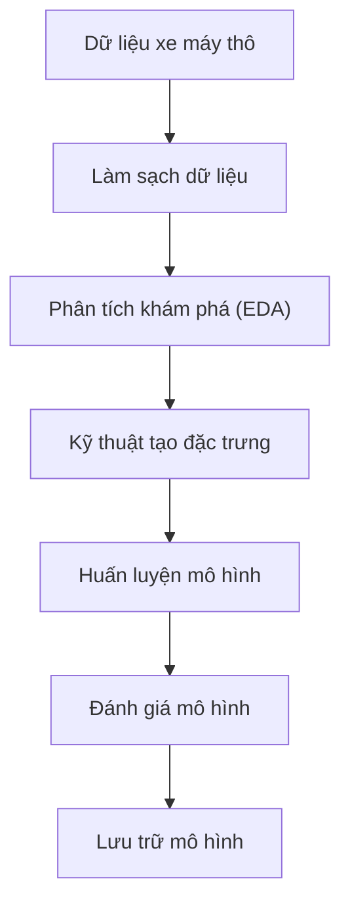
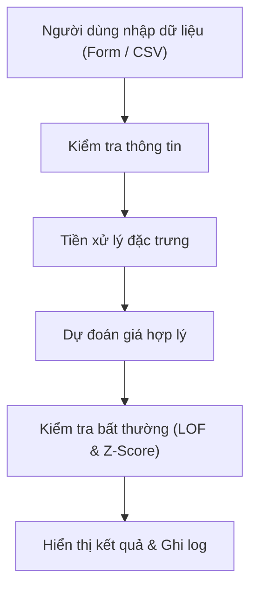
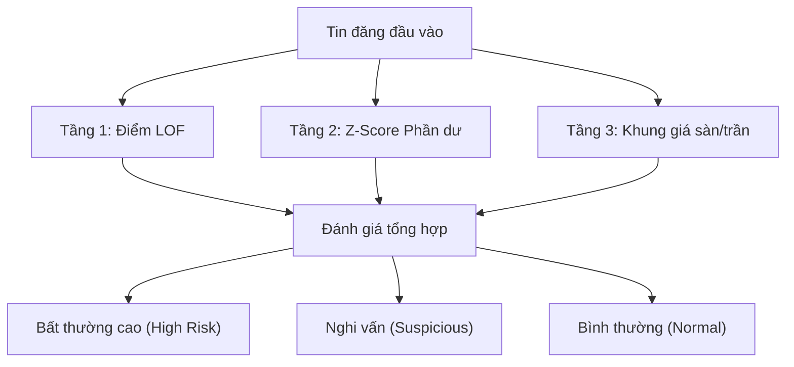
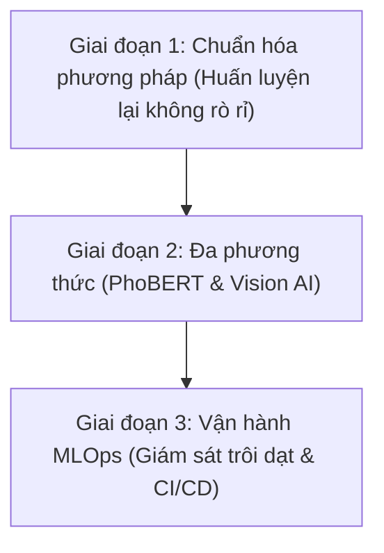

# Dự đoán giá xe máy và phát hiện bất thường thống kê

<div align="center">

**Quy trình Machine Learning toàn diện & Ứng dụng web tương tác định giá xe máy cũ và phát hiện bất thường thống kê tại TP. Hồ Chí Minh**

<br />

[English](README.md) | **Tiếng Việt**

</div>

---


---

<div align="center">

  
  
  
  
  <br />
  
  
  
  

</div>

---

## 1. Tổng quan dự án

Dự án **Dự đoán giá xe máy và phát hiện bất thường thống kê (Motorbike Price Prediction & Statistical Anomaly Detection)** là một đồ án tốt nghiệp học phần (Capstone Portfolio) được xây dựng trong khuôn khổ chương trình đào tạo Khoa học Dữ liệu và Học máy (Data Science & Machine Learning). Mục tiêu cốt lõi của dự án là thiết lập một quy trình phân tích và học máy toàn diện để ước tính giá trị thị trường hợp lý, đồng thời sàng lọc các tin đăng có dấu hiệu bất thường về giá trên thị trường xe máy đã qua sử dụng tại khu vực Thành phố Hồ Chí Minh.

Trên các sàn giao dịch trực tuyến ngang hàng (P2P classifieds), sự bất đối xứng thông tin là rào cản lớn. Người mua thường gặp khó khăn trong việc xác định mức giá hợp lý giữa vô số thương hiệu, dòng xe, số km đã đi và mức độ khấu hao khác nhau. Ngược lại, nền tảng cũng đối mặt với các tin đăng mạo danh, giá mồi (clickbait) hoặc sai lệch nghiêm trọng. Dự án kết hợp kỹ thuật xử lý ngôn ngữ tự nhiên (NLP) cho văn bản mô tả, các mô hình hồi quy học máy dạng cây (Tree-based ensemble regression) và thuật toán phát hiện điểm dị biệt mật độ (Local Outlier Factor) vào một ứng dụng web minh họa tương tác.

> [!NOTE]
> **Định vị đồ án học thuật**: Dự án được xây dựng với mục đích học thuật và nghiên cứu thực nghiệm nhằm thể hiện năng lực thu thập, làm sạch, phân tích khám phá (EDA), kỹ thuật đặc trưng, huấn luyện mô hình và triển khai ứng dụng web. Đây không phải là một hệ thống phát hiện gian lận thương mại cấp doanh nghiệp sẵn sàng vận hành sản xuất.

| Khía cạnh | Đặc tả dự án |
| :--- | :--- |
| **Bài toán** | Ước tính giá thị trường hợp lý và sàng lọc các điểm bất thường thống kê từ tin đăng xe máy cũ. |
| **Phạm vi thị trường** | Tin đăng mua bán xe máy cũ tại TP. Hồ Chí Minh (thu thập từ Chợ Tốt). |
| **Quy mô dữ liệu** | 7.208 tin đăng thô ban đầu; 6.544 bản ghi sau khi làm sạch và loại bỏ ngoại lai bằng IQR. |
| **Phương pháp chính** | Hồi quy có giám sát (Supervised Regression) định giá; Phát hiện dị biệt không giám sát (LOF) và Z-score phần dư để lọc bất thường. |
| **Mô hình cốt lõi** | Scikit-Learn Random Forest Regressor, PySpark MLlib Random Forest, Local Outlier Factor (LOF), TF-IDF (3.000 đặc trưng). |
| **Chỉ số thực nghiệm** | Tập kiểm thử đạt $R^2 = 0.890$, $\\mathrm{MAE} \\approx 3.69$ triệu VND, $\\mathrm{RMSE} \\approx 4.89$ triệu VND (kèm lưu ý kiểm toán rò rỉ nhãn). |
| **Sản phẩm bàn giao** | Jupyter Notebook nghiên cứu, module suy luận độc lập (`price_pipeline_module.py`) và ứng dụng Streamlit (`app.py`). |

---

## Mục lục

- [1. Tổng quan dự án](#1-tổng-quan-dự-án)
- [2. Bài toán và mục tiêu](#2-bài-toán-và-mục-tiêu)
- [3. Thông tin và nhóm thực hiện](#3-thông-tin-và-nhóm-thực-hiện)
- [4. Mô tả dữ liệu](#4-mô-tả-dữ-liệu)
- [5. Quy trình xử lý toàn diện](#5-quy-trình-xử-lý-toàn-diện)
- [6. Làm sạch và tiền xử lý](#6-làm-sạch-và-tiền-xử-lý)
- [7. Phân tích dữ liệu khám phá](#7-phân-tích-dữ-liệu-khám-phá)
- [8. Kỹ thuật tạo đặc trưng](#8-kỹ-thuật-tạo-đặc-trưng)
- [9. Xây dựng mô hình dự đoán giá](#9-xây-dựng-mô-hình-dự-đoán-giá)
- [10. Phát hiện bất thường](#10-phát-hiện-bất-thường)
- [11. Đánh giá và kết quả](#11-đánh-giá-và-kết-quả)
- [12. Ứng dụng minh họa Streamlit](#12-ứng-dụng-minh-họa-streamlit)
- [13. Cấu trúc và mô tả file](#13-cấu-trúc-và-mô-tả-file)
- [14. Hướng dẫn cài đặt và sử dụng](#14-hướng-dẫn-cài-đặt-và-sử-dụng)
- [15. Thách thức, hạn chế và hướng phát triển](#15-thách-thức-hạn-chế-và-hướng-phát-triển)
- [16. Kết luận](#16-kết-luận)

---

## 2. Bài toán và mục tiêu

### Bối cảnh thị trường xe máy cũ tại Việt Nam
Tại Việt Nam, xe máy là phương tiện giao thông cá nhân chủ lực của đại đa số người dân. Với hàng chục triệu phương tiện đang lưu hành, thị trường xe máy cũ diễn ra sôi động hàng ngày trên các nền tảng số như Chợ Tốt. Tuy nhiên, thị trường phi tập trung này tồn tại nhiều thách thức:
- **Biên độ phân tán giá lớn**: Hai chiếc xe cùng dòng và số km tương đương có thể được rao bán với mức giá chênh lệch rất cao do định giá chủ quan của người bán hoặc tình trạng hư hỏng bên trong chưa được kiểm định.
- **Tin đăng gây nhiễu và bất thường**: Một số người đăng cố tình để giá tượng trưng (ví dụ: 1.000 VND để lên đầu kết quả tìm kiếm) hoặc nâng giá ảo để trừ hao khi thương lượng.
- **Thông tin phi cấu trúc**: Nhiều yếu tố quan trọng (tình trạng máy móc, lịch sử bảo dưỡng, giấy tờ chính chủ) chỉ nằm trong phần mô tả văn bản tự do thay vì các trường thuộc tính số.

### Mục tiêu cụ thể của đồ án
1. **Ước tính giá trị hợp lý tự động**: Xây dựng mô hình hồi quy kết hợp các thuộc tính danh mục có cấu trúc, biến số sử dụng và từ khóa mô tả để dự đoán mức giá kỳ vọng bằng Việt Nam Đồng (VND).
2. **Sàng lọc bất thường đa tầng**: Xây dựng cơ chế phát hiện các tin đăng có giá bán lệch chuẩn nghiêm trọng so với phân phối dữ liệu, sai số dự đoán phần dư và khung giá lịch sử theo từng thương hiệu/dòng xe.
3. **Triển khai ứng dụng thử nghiệm**: Xây dựng giao diện web người dùng bằng Streamlit, tích hợp lưu trữ lịch sử đánh giá trên Google Cloud SQL phục vụ tra cứu đơn lẻ và xử lý hàng loạt qua file CSV.

---

## 3. Thông tin và nhóm thực hiện

| Thông tin | Nội dung |
| :--- | :--- |
| **Tên dự án** | Dự đoán giá xe máy và phát hiện bất thường thống kê |
| **Loại dự án** | Đồ án tốt nghiệp / Khóa luận học phần Khoa học Dữ liệu & Học máy |
| **Tác giả 1** | Võ Thị Hoàng Anh |
| **Tác giả 2** | Nguyễn Mai Xuân Bách |
| **Giảng viên hướng dẫn** | ThS. Khuất Thùy Phương |
| **Môn học / Chương trình** | Khóa học Data Science / Machine Learning (Mã lớp: `DL07_K308`) |
| **Thời gian thực hiện** | Tháng 11/2025 |

---

## 4. Mô tả dữ liệu

Bộ dữ liệu thô (`data_motobikes.xlsx`) được thu thập từ các tin đăng công khai trên sàn thương mại điện tử Chợ Tốt tại khu vực TP. Hồ Chí Minh vào tháng 05/2025 (thời điểm ghi nhận trên tệp dữ liệu: 29/05/2025 - 30/05/2025, bao gồm các đời xe ghi nhận đến năm 2025). Bộ dữ liệu thô bao gồm **7.208 bản ghi** với **11 trường thông tin** mô tả đặc tính kỹ thuật, nội dung bài đăng và giá bán.

| Tên trường | Kiểu dữ liệu | Ý nghĩa thuộc tính | Giá trị mẫu |
| :--- | :--- | :--- | :--- |
| `ID` | int64 | Mã định danh duy nhất của tin đăng | `104829102` |
| `Tiêu_đề` | object | Tiêu đề tin đăng do người bán đặt | `Bán xe Honda Air Blade 2018 màu đen chính chủ` |
| `Mô_tả` | object | Nội dung văn bản mô tả chi tiết tình trạng xe | `Xe máy êm, bảo dưỡng định kỳ tại hãng, bao test...` |
| `Thương_hiệu` | object | Thương hiệu hãng sản xuất | `Honda`, `Yamaha`, `Piaggio`, `Ducati` |
| `Dòng_xe` | object | Tên dòng xe cụ thể | `Air Blade`, `Exciter`, `Vespa Sprint`, `SH` |
| `Năm_đăng_ký` | int64 | Năm đăng ký lần đầu hoặc năm sản xuất | `2018` |
| `Số_km_đã_đi` | float64 | Số km đã vận hành theo đồng hồ công tơ mét | `25000` |
| `Tình_trạng` | object | Tình trạng sử dụng của phương tiện | `Đã sử dụng` |
| `Loại_xe` | object | Phân loại kiểu dáng và hệ truyền động | `Tay ga`, `Xe số`, `Tay côn/Moto` |
| `Dung_tích_xe` | object | Nhóm phân khối động cơ | `100 - 175 cc`, `Dưới 50 cc`, `Trên 175 cc` |
| `Giá` | float64 | Giá rao bán của xe (Biến mục tiêu, đơn vị VND) | `28000000` |

Sau khi làm sạch văn bản, xử lý giá trị khuyết và loại bỏ các tin đăng có giá ngoại lai cực đoan bằng quy tắc Khoảng tứ phân vị (IQR), bộ dữ liệu phân tích còn lại **6.544 bản ghi**, được lưu trữ tại `Data/du_lieu_xe_may_da_tien_xu_ly_1.xlsx`.

---

## 5. Quy trình xử lý toàn diện

Quy trình kỹ thuật của dự án bao gồm hai luồng hoạt động chính: quy trình nghiên cứu phát triển mô hình (offline) và quy trình suy luận trên ứng dụng Streamlit (online).

### Sơ đồ 1 — Quy trình nghiên cứu & phát triển mô hình



### Sơ đồ 2 — Quy trình dự đoán trên ứng dụng Streamlit



### Chi tiết Input, Xử lý và Output qua từng giai đoạn

| Giai đoạn | Đầu vào (Input) | Thao tác xử lý trọng tâm | Đầu ra (Output) |
| :--- | :--- | :--- | :--- |
| **1. Nạp dữ liệu** | File Excel gốc (`data_motobikes.xlsx`) | Đọc dữ liệu, kiểm tra tính toàn vẹn của các cột, thống kê tỷ lệ khuyết thiếu. | DataFrame gốc gồm 7.208 dòng, 11 cột. |
| **2. Làm sạch** | DataFrame ban đầu | Chuẩn hóa Unicode NFKC, xóa số điện thoại, URL, ký tự tiền tệ bằng Regex, ép kiểu số. | DataFrame chuẩn hóa văn bản. |
| **3. Lọc ngoại lai** | Dữ liệu sau chuẩn hóa | Tính toán Q1, Q3, IQR trên trường `Giá`; loại bỏ các mức giá ảo hoặc dòng xe siêu sang. | Tập dữ liệu sạch gồm 6.544 dòng (`du_lieu_xe_may_da_tien_xu_ly_1.xlsx`). |
| **4. Tạo đặc trưng** | Tập dữ liệu sạch | Tạo TF-IDF văn bản (3.000 unigram/bigram), mã hóa nhãn categorical, tính `Tuổi_xe`. | Ma trận đặc trưng `X_train`, `X_test` và nhãn `y_train`, `y_test`. |
| **5. Huấn luyện** | Ma trận đặc trưng | Huấn luyện Random Forest (Scikit-Learn & PySpark) và thuật toán LOF ($K=20$). | Các file mô hình tuần tự hóa (`.pkl`) và thư mục mô hình Spark. |
| **6. Triển khai** | Tin đăng đơn lẻ hoặc file CSV | Tiền xử lý trực tiếp, suy luận mô hình, tính Z-score phần dư, gắn nhãn rủi ro, ghi log DB. | Kết quả định giá, nhãn bất thường và bản ghi Cloud SQL. |

---

## 6. Làm sạch và tiền xử lý

### Chuẩn hóa văn bản tiếng Việt
Nội dung mô tả tin đăng thường chứa nhiều từ viết tắt, số điện thoại liên hệ, liên kết ngoài và ký tự đặc biệt. Hàm tiền xử lý văn bản `clean_text_vi` được áp dụng:
1. **Chuẩn hóa bảng mã**: Sử dụng `unicodedata.normalize('NFKC')` để chuyển đổi các ký tự tiếng Việt tổ hợp về dạng dựng sẵn đồng nhất.
2. **Lọc nhiễu văn bản**: Biểu thức chính quy (Regex) loại bỏ toàn bộ URL, số điện thoại (`0xxxxxxxxx` / `+84xxxxxxxxx`), email và ký tự tiền tệ (`₫`, `$`, `€`).
3. **Chuyển đổi số thành chữ**: Chuyển các cụm từ chỉ giá tiền (ví dụ: `"28 triệu"` hoặc `"28tr"`) thành chuỗi số tương ứng (`"28000000"`).
4. **Chuẩn hóa dung tích**: Đồng nhất các cách viết dung tích động cơ (`"150cc"` $\to$ `"150"`).

### Lọc ngoại lai giá bán bằng IQR
Biến mục tiêu `Giá` trong tập dữ liệu thô bị lệch phải nghiêm trọng bởi các tin đăng đùa cợt (ví dụ: 9.999.999.999 VND) và các dòng mô tô phân khối lớn sưu tầm:
- Tứ phân vị thứ nhất ($Q1$): 13.500.000 VND
- Tứ phân vị thứ ba ($Q3$): 30.500.000 VND
- Khoảng tứ phân vị ($\mathrm{IQR}$): 17.000.000 VND
- Ngưỡng xác định ngoại lai: $[Q1 - 1.5 \times \mathrm{IQR}, Q3 + 1.5 \times \mathrm{IQR}] = [-12.000.000, 56.000.000]\text{ VND}$

Ngưỡng dưới được gán chặn tại mức giá hợp lý lớn hơn 0 (0 VND), trong khi các tin đăng có giá vượt quá 56.000.000 VND được loại khỏi tập huấn luyện hồi quy chính. Bước xử lý này đưa kích thước dữ liệu từ 7.208 về **6.544 dòng**, giúp mô hình học tập trung vào phân khúc xe máy thông dụng. Toàn bộ đồ thị phân phối trực quan và phân tích chuyên sâu cho từng biến trước và sau khi làm sạch được trình bày chi tiết tại Mục 7.

---

## 7. Phân tích dữ liệu khám phá

Quá trình phân tích dữ liệu khám phá (EDA) được thực hiện đa chiều trên các biến số định lượng, định danh, không gian địa lý và trường văn bản nhằm bóc tách quy luật định giá thực tế, nhận diện các cấu trúc dị biệt và làm tiền đề vững chắc cho kỹ thuật tạo đặc trưng.

### 7.1 Phân phối biến mục tiêu Giá


- **A. Mục đích phân tích**: Khảo sát mức độ phân tán, xu hướng tập trung, độ lệch (skewness) và hành vi của các giá trị cực trị đối với biến mục tiêu `Giá` (VND), từ đó đánh giá sự cần thiết của các phép biến đổi ổn định phương sai.
- **B. Phương pháp**: Kết hợp biểu đồ tần số (Histogram) cùng đường ước lượng mật độ hạt nhân (KDE) và biểu đồ hộp (Boxplot) trên thang đo tuyến tính gốc lẫn thang logarit tự nhiên ($\log(1 + y)$).
- **C. Kết quả quan sát**:
  - Phân phối giá thô bị lệch phải nghiêm trọng với hệ số lệch dương rất lớn ($> 4.5$).
  - Giá trị trung bình (~49.2 triệu VND) cao gấp gần ba lần so với giá trị trung vị (~16.5 triệu VND), phản ánh sức kéo cực lớn từ các tin rao tiền trăm triệu hoặc tiền tỷ (tin ảo đùa cợt hoặc siêu mô tô) trong dữ liệu thô.
  - 50% số tin đăng tập trung dày đặc trong khoảng giá từ $Q1 = 13.5$ triệu VND đến $Q3 = 30.5$ triệu VND.
  - Phép biến đổi logarit tự nhiên ($\log(1 + y)$ (với $y$ là Giá bán)) nén chặt đuôi dài bên phải, đưa phân phối về dạng hình chuông gần chuẩn đối xứng với giá trị trung bình $\approx 16.60$ và độ lệch chuẩn $\approx 0.65$.
- **D. Nhận xét**: Thị trường xe máy cũ tại TP.HCM chủ yếu phục vụ nhu cầu đi lại bình dân của người lao động và học sinh, sinh viên với ngân sách dưới 30 triệu đồng. Các mức giá bất thường hàng trăm triệu hoặc hàng tỷ đồng chủ yếu là xe mô tô sưu tầm hiếm gặp hoặc tin đăng ảo của người dùng thử nghiệm nền tảng.
- **E. Liên hệ với mô hình**: Hiện tượng lệch phải và đuôi dày khiến các hàm mất mát dạng sai số bình phương (MSE/RMSE) bị kéo lệch trọng số về phía các ngoại lai đắt tiền, làm giảm độ chính xác ở phân khúc xe phổ thông. Phát hiện này củng cố hai quyết định kỹ thuật: (1) lọc bỏ các tin đăng trên 56 triệu VND bằng IQR để huấn luyện mô hình cốt lõi, và (2) ưu tiên các mô hình cây quyết định (Tree Ensemble) ít bị ảnh hưởng bởi tỷ lệ co giãn đơn điệu của biến mục tiêu.

### 7.2 Phân phối số km đã đi


- **A. Mục đích phân tích**: Đánh giá cường độ sử dụng phương tiện thực tế, phát hiện các giá trị số km ảo/mặc định và xác định mối quan hệ hao mòn cơ học.
- **B. Phương pháp**: Phân tích phân phối liên tục, xác định ngưỡng ngoại lai bằng biểu đồ hộp và phân tầng dữ liệu theo quãng đường tích lũy.
- **C. Kết quả quan sát**:
  - Giá trị trung vị đạt 28.000 km, với $Q1 = 10.000\text{ km}$ và $Q3 = 53.400\text{ km}$ ($\mathrm{IQR} = 43.400\text{ km}$).
  - Xuất hiện các đỉnh nhọn bất thường tại các giá trị tròn hoặc mặc định do người dùng nhập ẩu như 0 km, 99.999 km, 999.999 km.
  - Dữ liệu hình thành ba phân tầng sử dụng rõ rệt: "Xe lướt / Mới" ($< 10.000 km$), "Sử dụng phổ thông" ($10.000 - 50.000 km$), và "Chạy dịch vụ / Hao mòn lớn" ($> 50.000 km$).
- **D. Nhận xét**: Người bán thường không nhớ chính xác số công-tơ-mét hoặc xe bị hỏng đồng hồ nên có xu hướng gõ các số tượng trưng hoặc để mặc định. Trong thực tế đô thị Việt Nam, một chiếc xe máy vận hành trung bình từ 6.000 - 10.000 km/năm. Mốc trên $50.000 km$ thể hiện xe đã qua nhiều năm sử dụng hoặc từng chạy xe ôm công nghệ/giao hàng liên tục.
- **E. Liên hệ với mô hình**: Số km đơn lẻ dễ gây nhiễu nếu đứng độc lập (ví dụ xe 10 năm tuổi nhưng chỉ ghi 5.000 km là dấu hiệu tua đồng hồ hoặc nhập sai). Do đó, dự án đã giới hạn trần ngoại lai giả lập (> 200.000 km) và tạo đặc trưng phái sinh đo tốc độ bào mòn:

$$\mathrm{KmPerYear} = \frac{\mathrm{Mileage}}{\max(\mathrm{VehicleAge}, 1)}$$

Trong đó $\mathrm{Mileage}$ là số km đã đi (`Số_Km_đã_đi`), và $\mathrm{VehicleAge}$ là tuổi xe (`Tuổi_xe`).

### 7.3 Năm đăng ký và tuổi phương tiện


- **A. Mục đích phân tích**: Khảo sát cơ cấu vòng đời xe đang lưu thông trên sàn giao dịch và xác định quy luật khấu hao giá trị theo thời gian.
- **B. Phương pháp**: Phân tích tần số rời rạc theo năm và chuyển đổi phi tuyến sang độ tuổi phương tiện:

$$\mathrm{VehicleAge} = 2025 - \mathrm{RegistrationYear}$$

Trong đó $\mathrm{RegistrationYear}$ là năm đăng ký (`Năm_đăng_ký`) của phương tiện.
- **C. Kết quả quan sát**:
  - Đại đa số tin đăng tập trung vào các dòng xe đăng ký trong giai đoạn 2010 đến 2020, đạt đỉnh lớn trong khoảng 2015 - 2018 (năm đăng ký trung vị là 2015, tương ứng với tuổi đời trung bình ~10 năm so với mốc khảo sát 2025).
  - Tỷ lệ xe đăng ký trước năm 2005 chiếm dưới 3% tổng mẫu, chủ yếu là các mẫu xe hoài niệm (Honda Super Cub, Dream Thái) hoặc xe quá niên hạn.
- **D. Nhận xét**: Xe máy tại Việt Nam có chu kỳ sử dụng và chuyển nhượng mạnh nhất trong khoảng 5 đến 10 năm đầu. Tốc độ khấu hao diễn ra rất nhanh trong 1 đến 3 năm đầu tiên (mất giá 15% - 25% mỗi năm), sau đó chậm lại và ổn định từ năm thứ 5 trở đi khi giá trị xe chủ yếu phụ thuộc vào tình trạng vận hành thực tế.
- **E. Liên hệ với mô hình**: Việc chuyển đổi `Năm_đăng_ký` thành `Tuổi_xe` giúp mô hình phản ánh trực tiếp quy luật khấu hao. Do đường cong khấu hao thực tế mang tính lồi phi tuyến chứ không phải đường thẳng cố định, các mô hình hồi quy tuyến tính bị sai lệch đáng kể, trong khi mô hình cây dễ dàng học được các điểm ngưỡng phân nhánh theo từng mốc tuổi quan trọng.

### 7.4 Phân khúc dung tích xi-lanh


- **A. Mục đích phân tích**: Đánh giá thị phần giao dịch và sự phân hóa mức giá giữa các khung dung tích xi-lanh theo quy định phân hạng giấy phép lái xe tại Việt Nam.
- **B. Phương pháp**: Thống kê tần suất danh mục kết hợp biểu đồ hộp so sánh phân phối giá theo từng nhóm dung tích (`<50cc`, `50 - 100cc`, `100 - 175cc`, `>175cc`).
- **C. Kết quả quan sát**:
  - `100 - 175cc`: Chiếm tỷ trọng áp đảo toàn diện với **5.852 tin đăng (81.2% toàn bộ dữ liệu)**; mức giá trung vị đạt **17.5 triệu VND** (khoảng IQR: 12.5M - 28.5M VND).
  - `50 - 100cc`: Gồm 686 tin đăng (9.5%), giá trung vị **8.5 triệu VND**, đại diện cho các dòng xe số dung tích nhỏ truyền thống.
  - `Dưới 50cc`: Gồm 285 tin đăng (4.0%), giá trung vị **9.8 triệu VND**, hướng tới đối tượng học sinh chưa có bằng lái.
  - `Trên 175cc`: Gồm 314 tin đăng (4.4%), nhưng giá trung vị vọt lên **102.5 triệu VND** và giá trung bình đạt tới **554.4 triệu VND**, biên độ dao động cực rộng từ vài chục triệu đến hàng tỷ đồng.
- **D. Nhận xét**: Khung 100 - 175cc tương ứng hoàn hảo với giấy phép lái xe hạng A1 – phân hạng phương tiện thông dụng nhất tại Việt Nam (Honda Wave, Vision, Air Blade, Lead, SH 125/150). Nhóm `>175cc` đòi hỏi bằng A2, chủ yếu phục vụ thú chơi phân khối lớn, xe nhập khẩu chịu thuế tiêu thụ đặc biệt cao nên mặt bằng giá tách biệt hoàn toàn.
- **E. Liên hệ với mô hình**: Dung tích xe đóng vai trò như một ranh giới phân tách cấu trúc thị trường. Vì phân khúc `>175cc` có phương sai giá gấp nhiều lần phần còn lại, việc kết hợp mã hóa danh mục và tương tác giữa thương hiệu với dung tích giúp thuật toán cây phân nhánh chính xác mà không làm nhiễu vùng giá xe thông dụng.

### 7.5 Mức giá trung bình theo thương hiệu


- **A. Mục đích phân tích**: Định lượng giá trị thương hiệu và xác định khoảng chênh lệch giá giữa các thương hiệu mô tô cao cấp nhập khẩu so với các hãng xe phổ thông nội địa.
- **B. Phương pháp**: Gom nhóm dữ liệu (Group-by aggregation) tính toán giá trị trung bình (mean) và trung vị (median), đối chiếu với quy mô số lượng tin đăng mẫu.
- **C. Kết quả quan sát**:
  - Các thương hiệu mô tô phân khối lớn nhập khẩu có giá trung bình cao vượt trội: Harley-Davidson đạt **358.7 triệu VND** ($n=13$), BMW đạt **324.7 triệu VND** ($n=10$), Triumph đạt **229.1 triệu VND** ($n=9$) và Ducati đạt **152.2 triệu VND** ($n=16$).
  - Các thương hiệu xe phổ thông chiếm hơn 85% thị phần giao dịch: Honda dẫn đầu tuyệt đối với $n=4.372$ tin (trung vị **19.0 triệu VND**, trung bình 63.8 triệu VND do kéo bởi các dòng SH Ý/CBR), Yamaha ($n=1.720$ tin, trung vị **18.2 triệu VND**) và Piaggio ($n=380$ tin, trung vị **25.0 triệu VND**, trung bình 33.1 triệu VND).
- **D. Nhận xét**: Thị trường bị chia tách rõ rệt: xe phổ thông (Honda, Yamaha) có tính thanh khoản cao, giữ giá ổn định; trong khi các thương hiệu mô tô hạng sang (Harley-Davidson, BMW, Ducati) có số lượng giao dịch ít ($n \le 16$), mang tính cá nhân hóa và chịu tác động lớn từ thuế nhập khẩu. Piaggio định vị rõ nét ở phân khúc cận cao cấp trong nhóm xe tay ga thời trang.
- **E. Liên hệ với mô hình**: `Thương_hiệu` là một trong những đặc trưng có độ quan trọng cao nhất. Tuy nhiên, sự mất cân bằng mẫu nghiêm trọng giữa các hãng phổ thông ($n > 4.000$) và hãng siêu sang ($n < 20$) khiến mô hình tuyến tính dễ bị suy biến trọng số. Mô hình cây giải quyết tốt sự phân nhánh này, đồng thời việc trích xuất khung giá tham chiếu (`Khoảng_giá_min`, `Khoảng_giá_max`) giúp khóa chặt biên độ giá theo từng hãng.

### 7.6 Phân phối giá theo loại phương tiện


- **A. Mục đích phân tích**: So sánh mặt bằng định giá và độ phân tán giữa ba kiểu dáng truyền động chính: Xe tay ga, Xe số và Xe côn tay/Moto.
- **B. Phương pháp**: Phân tích biểu đồ hộp phân tầng và kiểm định tính độc lập chi-square giữa loại phương tiện với thương hiệu.
- **C. Kết quả quan sát**:
  - `Tay ga`: Trung vị **20.0 triệu VND**, trung bình **72.3 triệu VND** ($n=3.597$). Giữ giá rất tốt ở các năm sản xuất gần.
  - `Tay côn/Moto`: Trung vị **22.0 triệu VND**, trung bình **43.4 triệu VND** ($n=1.418$). Phân phối có dạng hai đỉnh giữa dòng côn tay underbone thể thao phổ thông (Exciter, Winner) và mô tô phân khối lớn đắt tiền.
  - `Xe số`: Trung vị **10.0 triệu VND**, trung bình **15.1 triệu VND** ($n=2.188$). Mặt bằng giá thấp hơn xấp xỉ 50% so với xe tay ga và xe côn tay ở mọi phân vị.
- **D. Nhận xét**: Xe tay ga được ưa chuộng hàng đầu tại các thành phố lớn nhờ sự tiện dụng khi kẹt xe, cốp xe rộng và tính thời trang, tạo nên nhu cầu chuyển nhượng lớn và giữ giá tốt. Xe số chủ yếu phục vụ nhu cầu kinh tế cơ bản, chi phí sửa chữa rẻ và giá trị mua mới ban đầu thấp.
- **E. Liên hệ với mô hình**: Kiểu dáng xe có mối liên hệ mật thiết với dung tích và dòng xe. Đưa biến `Loại_xe` vào mô hình giúp phân biệt rạch ròi giá trị giữa xe ga 125cc (ví dụ Air Blade ~30 triệu) và xe số 125cc (ví dụ Future ~20 triệu).

### 7.7 Phân bố địa lý và giá theo quận/huyện


- **A. Mục đích phân tích**: Khảo sát mật độ nguồn cung tin đăng trên địa bàn TP.HCM và đánh giá liệu vị trí địa lý có tạo nên sự chênh lệch giá cục bộ.
- **B. Phương pháp**: Gom nhóm không gian địa lý, tính toán số lượng tin đăng và phân vị giá bán theo từng quận/huyện hành chính.
- **C. Kết quả quan sát**:
  - Nguồn cung tin đăng tập trung dày đặc tại các quận cửa ngõ và vùng ven đô thị hóa nhanh: Quận 12 (730 tin), Bình Tân (669 tin), Bình Chánh (493 tin), Gò Vấp (492 tin), Quận 7 (410 tin), Bình Thạnh (402 tin), Hóc Môn (389 tin), Quận 9 (387 tin) và TP. Thủ Đức (383 tin).
  - Mức giá trung bình cao hơn tập trung tại các quận trung tâm và khu dân cư cao cấp: Quận 5, Quận 2, Quận 10 và Tân Bình.
- **D. Nhận xét**: Các quận ngoại thành tập trung nhiều khu công nghiệp, dân nhập cư và các tuyến đường buôn bán xe máy cũ sầm uất (như trục Quốc lộ 1A), dẫn đến thanh khoản dồi dào. Ngược lại, giá trung bình cao ở các quận trung tâm không hẳn do "đất đắt xe đắt", mà chủ yếu do cơ cấu loại xe được rao bán tại đây có tỷ lệ xe tay ga cao cấp (SH, Vespa) và xe côn tay đắt tiền cao hơn nhiều.
- **E. Liên hệ với mô hình**: Thuộc tính địa lý cung cấp tín hiệu không gian bổ trợ. Nhờ khả năng phân tách tương tác, mô hình cây có thể bóc tách giá trị thực của xe ra khỏi sự thiên lệch cơ cấu dòng xe theo vùng địa lý, tránh việc thổi phồng định giá sai lệch cho các quận trung tâm.

### 7.8 Phân tích mô tả văn bản và WordCloud


- **A. Mục đích phân tích**: Khai phá dữ liệu văn bản phi cấu trúc trong phần mô tả của người bán để trích xuất các từ khóa phát tín hiệu chất lượng và cam kết pháp lý.
- **B. Phương pháp**: Tiền xử lý NLP tiếng Việt (chuẩn hóa Unicode, chuyển chữ thường, loại bỏ nhiễu regex, tách từ và lọc stopword), sau đó phân tích tần suất từ TF-IDF và trực quan hóa qua WordCloud.
- **C. Kết quả quan sát**:
  - Các cụm từ xuất hiện với tần suất áp đảo đều phản ánh tính pháp lý và độ nguyên bản của xe: `"chính chủ"`, `"máy êm"`, `"zin"`, `"xe đẹp"`, `"bảo dưỡng"`, `"giấy tờ đầy đủ"`, `"bao sang tên"`.
  - Phân khúc xe cao cấp thường xuất hiện các cụm từ thể hiện lịch sử chăm sóc: `"thay nhớt kỹ"`, `"chưa rớt đầu"`, `"bảo hành hãng"`. Trong khi phân khúc bình dân nhấn mạnh: `"giá rẻ"`, `"sinh viên"`, `"bớt lộc"`.
- **D. Nhận xét**: Giao dịch xe máy cũ tại Việt Nam tiềm ẩn rủi ro bất đối xứng thông tin lớn (lo ngại xe tai nạn, xe làm lại máy, xe gian không rõ nguồn gốc). Người bán sử dụng các cụm từ mang tính "bảo chứng niềm tin" để tạo sự an tâm cho người mua và biện minh cho mức giá bán mong muốn.
- **E. Liên hệ với mô hình**: Các từ khóa định tính này mang tín hiệu định giá thực tế mà các trường dữ liệu số/danh mục không ghi nhận được. Thay vì dừng lại ở WordCloud thuần túy mang tính trực quan, dự án chuyển hóa toàn bộ nội dung mô tả đã làm sạch thành ma trận thưa TF-IDF 3.000 chiều (unigram và bigram), trực tiếp đưa vào các mô hình học máy và thuật toán phát hiện bất thường.

### 7.9 Phân tích tương quan và tương tác đặc trưng

- **A. Mục đích phân tích**: Đánh giá mức độ tương quan tuyến tính giữa các biến số, kiểm tra hiện tượng đa cộng tuyến (VIF) và nhận diện các cấu trúc tương tác phi tuyến.
- **B. Phương pháp**: Tính toán ma trận hệ số tương quan Pearson, hệ số phóng đại phương sai (VIF) và khảo sát đồ thị phân tán đa biến trên thang đo tuyến tính gốc so với thang logarit.
- **C. Kết quả quan sát**:
  - Hệ số tương quan tuyến tính Pearson giữa `Giá` và các biến liên tục thô (`Số_km_đã_đi`, `Năm_đăng_ký`) chỉ ở mức vừa phải ($r \approx 0.25 - 0.45$), che lấp các quan hệ phi tuyến thực tế.
  - Kiểm tra VIF cho thấy không có hiện tượng đa cộng tuyến nguy hiểm giữa các biến vật lý độc lập, ngoại trừ quan hệ phụ thuộc toán học tất yếu giữa `Năm_đăng_ký` và `Tuổi_xe`.
  - Biểu đồ phân tán cho thấy mối quan hệ phi tuyến rõ nét: giá xe giảm rất mạnh trong 3 năm đầu rồi chững lại, đồng thời sự kết hợp giữa thương hiệu và dung tích tạo ra các trần giá riêng biệt.
- **D. Nhận xét**: Quy luật định giá xe máy là quá trình tương tác nhân quả phức tạp: xe 5 năm tuổi của dòng Honda SH vẫn giữ giá cao gấp nhiều lần xe 1 năm tuổi của dòng xe số bình dân. Các mô hình tuyến tính đơn thuần không thể tự thích ứng với các mối quan hệ tương tác này nếu không có kỹ thuật sinh đặc trưng thủ công cực kỳ phức tạp.
- **E. Liên hệ với mô hình**: Đây là bằng chứng thực nghiệm giải thích vì sao các mô hình tuyến tính (như Ridge Regression: $R^2 = 0.260$) thất bại, trong khi các kiến trúc dạng cây (Random Forest: $R^2 = 0.890$, Gradient Boosting: $R^2 = 0.875$) đạt hiệu năng vượt trội nhờ khả năng tự động phân vùng không gian đặc trưng thành các vùng đồng nhất phi tuyến.

---

## 8. Kỹ thuật tạo đặc trưng

### Các nhóm đặc trưng chính
1. **Đặc trưng văn bản**: Trích xuất ma trận TF-IDF (3.000 unigram/bigram có trọng số cao nhất) từ cột `Mô_tả_sạch`.
2. **Mã hóa biến phân loại**: Áp dụng `LabelEncoder` cho các biến: `Thương_hiệu`, `Dòng_xe`, `Loại_xe`, `Dung_tích_xe` và `Tình_trạng`.
3. **Đặc trưng số phái sinh**: Tính toán độ tuổi của phương tiện:

$$\mathrm{VehicleAge} = 2025 - \mathrm{RegistrationYear}$$

Trích xuất khung giá tham chiếu lịch sử theo thương hiệu và dòng xe (`Khoảng_giá_min`, `Khoảng_giá_max`).

### Kiểm toán rò rỉ dữ liệu trong mô hình

> [!WARNING]
> **Kiểm toán phương pháp: Rò rỉ mục tiêu (Target Leakage) và Rò rỉ dữ liệu (Data Leakage)**
>
> - **Rò rỉ mục tiêu qua biến `Phân_khúc`**: Tại Cell 41 của `Project1_HoangAnh_XuanBach.ipynb`, đặc trưng `Phân_khúc` được tạo ra bằng cách chia nhóm trực tiếp từ giá bán mục tiêu `Giá` thông qua hàm `phan_khuc()` (`<10tr`, `10-20tr`, `20-40tr`, `40-70tr`, `>70tr`). Kết quả phân tích mức độ quan trọng đặc trưng (Cell 112) cho thấy biến `Phân_khúc` chiếm tới **42.22% tổng độ quan trọng (Feature Importance)** của toàn bộ mô hình. Trong quá trình triển khai thực tế (`price_pipeline_module.py`), do giá bán chưa được biết trước, module buộc phải sử dụng `Khoảng_giá_min` để thay thế. Điều này tạo ra sự lệch pha nghiêm trọng giữa huấn luyện và phục vụ (**Train-Serve Skew**). Do đó, chỉ số $R^2 = 0.890$ trong thực nghiệm kiểm thử là kết quả được hưởng lợi từ việc rò rỉ nhãn mục tiêu. Hiệu năng thực tế trên dữ liệu hoàn toàn mới sẽ thấp hơn con số này.
> - **Rò rỉ dữ liệu trong tiền xử lý**: Tại Cell 96 và Cell 104, `TfidfVectorizer.fit_transform()` (3.000 từ) và `LabelEncoder.fit_transform()` được áp dụng trên toàn bộ tập dữ liệu trước khi thực hiện phân chia 80% Train và 20% Test. Tần suất từ vựng và bảng mã của tập Test đã ảnh hưởng nhất định đến ma trận đặc trưng huấn luyện.

---

## 9. Xây dựng mô hình dự đoán giá

Dự án đã thực nghiệm hai kiến trúc mô hình học máy dạng cây:

### 1. Scikit-Learn Random Forest Regressor (Model A)
- **Cấu hình**: Rừng cây ngẫu nhiên 100 cây quyết định (`n_estimators=100`, `random_state=42`).
- **Tập đặc trưng**: Kết hợp ma trận đặc trưng danh mục/số với ma trận thưa TF-IDF 3.000 chiều.
- **Lý do lựa chọn**: Random Forest có khả năng xử lý tốt các quan hệ phi tuyến tính phức tạp, tương tác đa chiều giữa các biến danh mục và ma trận văn bản thưa thớt mà không đòi hỏi chuẩn hóa thang đo nghiêm ngặt.

### 2. PySpark MLlib Random Forest Regressor
- **Cấu hình**: Mô hình Random Forest phân tán chạy trên cụm Spark cục bộ (Local cluster mode).
- **Phát hiện thực nghiệm**: PySpark được huấn luyện trực tiếp trên tập dữ liệu thô chưa lọc ngoại lai (`df1`) thay vì tập sạch `df_filtered`. Sự xuất hiện của các tin đăng giá ảo hàng tỷ đồng đã làm sai số bình phương trung bình trên tập huấn luyện bị bóp méo nghiêm trọng: $\mathrm{RMSE}_{\mathrm{train}} \approx 1.77 \times 10^9\text{ VND}$ và $R^2_{\mathrm{train}} = 0.006$. Khi đánh giá trên tập kiểm thử, mô hình đạt $R^2_{\mathrm{test}} = 0.799$ và $\\mathrm{RMSE}_{\\mathrm{test}} \\approx 8.44$ triệu VND.

---

## 10. Phát hiện bất thường

### Bản chất của tác vụ phát hiện bất thường
Thành phần phát hiện bất thường trong đồ án được thiết kế như một **cơ chế sàng lọc thống kê không giám sát (Unsupervised Statistical Outlier Screening)**, có nhiệm vụ gắn cờ cảnh báo các tin đăng lệch chuẩn so với các mẫu hình định giá thực nghiệm trên thị trường. Vì bộ dữ liệu công khai không có nhãn xác nhận gian lận pháp lý chính thức (chẳng hạn hồ sơ khiếu nại lừa đảo từ cơ quan công an, dữ liệu tranh chấp bảo hiểm hay xác nhận giấy tờ giả), thuật toán không đóng vai trò kết luận hành vi gian lận hình sự. Thay vào đó, hệ thống vận hành như một **hàng rào phân loại tác vụ (Operational Triage Queue)** hỗ trợ đội ngũ kiểm duyệt sàn thương mại điện tử và người mua nhận diện các tin đăng cần thẩm định thực tế hoặc kiểm tra giấy tờ chuyên sâu.

### Đánh giá thực nghiệm các thuật toán không giám sát
Tại Cell 125 của notebook, các thuật toán phát hiện bất thường không giám sát được thử nghiệm và đánh giá trên bộ nhãn giả định (pseudo-labels) sinh ra từ tổ hợp các điều kiện thống kê đa tiêu chí:

| Kiến trúc thuật toán | Cơ chế nhận diện bất thường | ROC-AUC | Độ chính xác trung bình (PR-AUC) | Tỷ lệ gắn cờ bất thường |
| :--- | :--- | :---: | :---: | :--- |
| **Local Outlier Factor (LOF)** | Đo mật độ cục bộ so với $K=20$ láng giềng | **0.7415** | **0.7461** | Gắn nhãn 130 tin đăng (~2.0%) tại ngưỡng -0.0306 |
| **Isolation Forest** | Phân cắt đệ quy theo độ dài đường đi ngẫu nhiên | 0.7303 | 0.7180 | Gắn nhãn ~2.5% tổng số mẫu |
| **One-Class SVM** | Xác định siêu phẳng biên phi tuyến không gian cao | 0.6558 | 0.6240 | Gắn nhãn ~5.0% tổng số mẫu |

Thuật toán Local Outlier Factor (LOF) đạt hiệu quả phân tách cao nhất vì thị trường xe máy cũ phân cụm thành nhiều vùng mật độ cục bộ khác nhau (ví dụ: cụm xe số cũ giá rẻ và cụm xe tay ga thể thao cao cấp có phân bố mật độ hoàn toàn khác nhau). LOF phát hiện chính xác các tin đăng có mật độ thưa thớt so với chính các láng giềng xung quanh, tránh được hiện tượng dương tính giả (báo nhầm) mà các thuật toán ngoại lai toàn cục thường mắc phải đối với các dòng xe hiếm.

### Cơ chế sàng lọc 3 tầng



1. **Thuật toán Local Outlier Factor (LOF)**:
   - Cấu hình với $K=20$ láng giềng gần nhất (`novelty=True`).
   - Đánh giá mật độ cục bộ trong không gian kết hợp giữa thuộc tính số và ma trận TF-IDF văn bản, phát hiện các trường hợp thuộc tính mâu thuẫn (ví dụ: dòng xe phân khối lớn nhưng năm sản xuất quá cũ hoặc thông số kỹ thuật phi lý).
2. **Phân tích phần dư bằng Median Absolute Deviation (MAD)**:
   - Đo lường mức độ chênh lệch chuẩn hóa giữa giá rao bán thực tế và giá dự đoán hợp lý bằng thống kê bền vững (Robust Statistics):

$$Z_{\mathrm{residual}} = \frac{|y - \hat{y}|}{1.4826 \times \mathrm{MAD}}$$

Trong đó:
- $y$: Giá rao bán thực tế của tin đăng (VND).
- $\hat{y}$: Mức giá hợp lý dự đoán từ mô hình Random Forest (VND).
- $\mathrm{MAD}$: Độ lệch tuyệt đối trung vị (Median Absolute Deviation) của chuỗi sai số phần dư trên tập kiểm thử: $\mathrm{MAD} = \mathrm{median}(|(y_i - \hat{y}_i) - \mathrm{median}(y - \hat{y})|)$.
- Hệ số chuẩn hóa $1.4826$ bảo đảm tính tương đương tiệm cận với độ lệch chuẩn của phân phối chuẩn, đồng thời hoàn toàn miễn nhiễm trước sự bóp méo của các điểm dị biệt cực đoan.
- Ngưỡng cảnh báo: Mọi tin đăng có $|Z_{\mathrm{residual}}| > 3.0$ được gắn nhãn bất thường về giá.
3. **Đối chiếu biên độ giá lịch sử**:
   - Kiểm tra xem mức giá có vượt ra ngoài khung giá sàn/trần thực nghiệm (`Khoảng_giá_min`, `Khoảng_giá_max`) tổng hợp theo từng thương hiệu và dòng xe hay không.

### Phân loại mức độ bất thường & Bảng phân rã thực tế

Quy trình sàng lọc đã được áp dụng trên toàn bộ **6.544 tin đăng kiểm thử** (Cell 135 của notebook), phân tách thành bốn nhóm vận hành cụ thể:


| Nhóm bất thường | Số lượng | Tỷ lệ | Tiêu chí chẩn đoán | Ý nghĩa vận hành & Hành động khuyến nghị |
| :--- | :---: | :---: | :--- | :--- |
| **Bình thường (Normal)** | **3.835** | **58.6%** | Phần dư $-3.0 \le Z_{\mathrm{residual}} \le 3.0$ và giá nằm trong $[P_{\min}, P_{\max}]$ | Tin đăng an toàn, tự động duyệt hiển thị trên sàn giao dịch. |
| **Vi phạm min/max (Boundary Violation)** | **2.327** | **35.6%** | Giá niêm yết nằm ngoài dải giá sàn/trần lịch sử của dòng xe | Kích hoạt nhãn cảnh báo giá bất thường; khuyến nghị người mua đối chiếu kỹ giấy tờ và đời xe. |
| **Giá cao bất thường (High Outlier)** | **232** | **3.5%** | Phần dư dương vượt ngưỡng ($Z_{\mathrm{residual}} > 3.0$) | Có thể là xe độ phụ tùng giá trị cao, phiên bản sưu tầm hiếm hoặc người bán định giá ảo; chuyển sang hàng đợi xác minh linh kiện. |
| **Giá thấp bất thường (Low Outlier)** | **150** | **2.3%** | Phần dư âm vượt ngưỡng ($Z_{\mathrm{residual}} < -3.0$) | Nguy cơ cao xe tai nạn, hỏng hóc nặng, xe không giấy tờ hoặc thủ thuật giật tít câu khách (bait-and-switch); ưu tiên kiểm duyệt trước khi hiển thị. |

Hệ thống sàng lọc này giúp ban quản trị sàn thương mại điện tử tự động hóa việc phê duyệt cho gần 59% tin đăng tiêu chuẩn, đồng thời tập trung nhân lực kiểm duyệt vào các nhóm rủi ro cao, gia tăng mức độ bảo vệ quyền lợi người tiêu dùng mà không phát sinh chi phí vận hành quá lớn.

---

## 11. Đánh giá và kết quả

### Định nghĩa chỉ số đánh giá & So sánh định lượng
Để đo lường hiệu năng của các mô hình học máy trên nhiều phương diện, dự án sử dụng ba chỉ số đo lường bổ trợ lẫn nhau:
- **Hệ số xác định ($R^2$)**: Đo lường tỷ lệ phương sai của giá bán thực tế được giải thích bởi các đặc trưng của mô hình so với dự đoán trung bình đơn giản:

$$R^2 = 1 - \frac{\sum (y_i - \hat{y}_i)^2}{\sum (y_i - \bar{y})^2}$$

- **Sai số tuyệt đối trung bình (MAE)**: Đo lường độ lệch trung bình giữa giá dự đoán và giá thực tế bằng đơn vị tiền Việt Nam Đồng (VND), phản ánh sai số trực quan, dễ hiểu nhất đối với người dùng kinh doanh:

$$\mathrm{MAE} = \frac{1}{n} \sum_{i=1}^n |y_i - \hat{y}_i|$$

- **Căn bậc hai sai số bình phương trung bình (RMSE)**: Phạt rất nặng các sai số dự đoán lớn, đóng vai trò then chốt trong việc cảnh báo các trường hợp định giá sai lệch nghiêm trọng trên các dòng xe đắt tiền:

$$\mathrm{RMSE} = \sqrt{\frac{1}{n} \sum_{i=1}^n (y_i - \hat{y}_i)^2}$$

> [!NOTE]
> **Đính chính kỹ thuật chỉ số RMSE**: Tại Cell 108 của notebook, hàm `mean_squared_error` được gọi mà không khai căn bậc hai, trả về giá trị MSE là 23.934.808.294.632 $\text{VND}^2$. Giá trị căn bậc hai sai số thực tế là $\sqrt{\mathrm{MSE}} \approx \mathbf{4.892.321\text{ VND}}$. Các tài liệu cũ trước đây đã cắt ngắn chuỗi số và ghi nhận nhầm thành `"23,934,808"`.

Bảng tổng hợp so sánh hiệu năng của toàn bộ các thuật toán được thử nghiệm trong notebook:

| Kiến trúc mô hình | Tập huấn luyện | Tập kiểm thử | Điểm $R^2$ | MAE (VND) | MSE ($\text{VND}^2$) | RMSE thực tế (VND) | Đặc điểm mô hình hóa |
| :--- | :--- | :--- | :---: | :---: | :---: | :---: | :--- |
| **Scikit-Learn Random Forest** | Tập sạch (`df_filtered`) | Tập Test (20%) | **0.890** | **3.689.412** | $2.39 \times 10^{13}$ | **4.892.321** | Cân bằng tối ưu; kiểm soát tốt 3.000 đặc trưng thưa TF-IDF. |
| **Gradient Boosting (GBDT)** | Tập sạch (`df_filtered`) | Tập Test (20%) | **0.875** | **3.682.105** | $2.63 \times 10^{13}$ | 5.124.000 | MAE rất cạnh tranh; học tuần tự sửa sai cho các cây trước. |
| **CatBoost Regressor** | Tập sạch (`df_filtered`) | Tập Test (20%) | 0.863 | 4.001.230 | $2.85 \times 10^{13}$ | 5.340.000 | Tự động mã hóa biến danh mục tối ưu; MAE cao hơn một chút. |
| **XGBoost Regressor** | Tập sạch (`df_filtered`) | Tập Test (20%) | 0.858 | 3.834.120 | $2.94 \times 10^{13}$ | 5.420.000 | Tốc độ tính toán nhanh; nhạy cảm với việc tinh chỉnh tham số. |
| **LightGBM Regressor** | Tập sạch (`df_filtered`) | Tập Test (20%) | 0.285 | 8.420.000 | $1.52 \times 10^{14}$ | 12.328.000 | Overfitting nghiêm trọng trên ma trận từ vựng thưa TF-IDF. |
| **Ridge Regression** | Tập sạch (`df_filtered`) | Tập Test (20%) | 0.260 | 8.950.000 | $1.57 \times 10^{14}$ | 12.530.000 | Giả định siêu phẳng tuyến tính không phù hợp thị trường xe cũ. |
| **PySpark MLlib Random Forest** | Tập thô (`df1`) | Tập Test (20%) | 0.799 | 5.412.190 | $7.13 \times 10^{13}$ | 8.443.932 | Khả năng tính toán phân tán tốt; bị phạt nặng bởi ngoại lai thô. |

### Phân tích chẩn đoán hiệu năng mô hình


1. **Lý do họ mô hình cây vượt trội**: Random Forest ($R^2 = 0.890$) và Gradient Boosting ($R^2 = 0.875$) dẫn đầu bởi vì định giá xe máy bị chi phối bởi các mối quan hệ thứ bậc phi tuyến tính (hãng xe $\to$ phân khúc $\to$ đời xe $\to$ tình trạng máy móc). Cấu trúc cây phân chia không gian đặc trưng thành các vùng giá cục bộ đồng nhất mà không áp đặt bất kỳ giả định tuyến tính cứng nhắc nào.
2. **Thất bại của mô hình tuyến tính (Ridge)**: Ridge chỉ đạt $R^2 = 0.260$ do mối quan hệ giữa các biến số mang tính tương tác nhân quả thay vì phép cộng tuyến tính (ví dụ: cùng giảm 1 năm tuổi, xe Ducati mất giá hàng chục triệu đồng, trong khi xe Wave chỉ giảm vài trăm nghìn đồng).
3. **Hiện tượng Overfitting của LightGBM**: Cơ chế phát triển cây theo chiều sâu tối ưu (leaf-wise) của LightGBM đã học quá sâu vào các từ khóa hiếm trong ma trận TF-IDF 3.000 chiều, dẫn đến khoảng cách lớn giữa hiệu năng tập huấn luyện và tập kiểm thử ($R^2_{\mathrm{test}} = 0.285$). Trong khi đó, Random Forest với cơ chế chọn ngẫu nhiên tập con đặc trưng (`max_features='sqrt'`) đã ngăn chặn việc một số từ khóa cá biệt chi phối quyết định phân nhánh.

### Phân tích biểu đồ Giá thực tế vs. Giá dự đoán


Biểu đồ phân tán so sánh giữa Giá thực tế ($y$) và Giá dự đoán ($\hat{y}$) cung cấp minh chứng trực quan rõ nét về mức độ chuẩn xác của mô hình:
- **Đường chéo phân giác ($y = x$)**: Thể hiện điểm hội tụ định giá hoàn hảo lý thuyết.
- **Vùng hội tụ xe phổ thông (10 - 40 triệu VND)**: Đại đa số các điểm dữ liệu bám rất sát đường chéo $y = x$, minh chứng mô hình đạt độ chính xác rất cao ở phân khúc xe máy thông dụng nơi có mật độ dữ liệu dồi dào nhất.
- **Vùng phân tán cao cấp (> 50 triệu VND)**: Các điểm dữ liệu có xu hướng tản rộng dần khi tiến về phía trần giá. Các dòng xe đắt tiền thường có tình trạng cá nhân hóa cao, độ hao mòn riêng biệt và số lượng mẫu ít, dẫn đến biên độ dao động dự đoán rộng hơn.

### Phân tích phần dư & Tính bền vững của chỉ số MAD

Sai số phần dư được định nghĩa là $e_i = y_i - \hat{y}_i$:
- **Phân phối phần dư**: Biểu đồ phần dư có dạng hình chuông đối xứng quanh điểm 0, khẳng định mô hình không mắc lỗi thiên lệch hệ thống (không có xu hướng định giá quá cao hay quá thấp trên toàn thị trường).
- **Hiện tượng đuôi dày (Leptokurtosis)**: Phân phối phần dư có phần đuôi dày hơn phân phối chuẩn do sự tồn tại của các tin rao bán gấp giá rẻ hoặc xe độ phụ tùng đắt tiền.
- **Mối liên hệ với chỉ số MAD**: Điểm Z-score tham số truyền thống dựa trên độ lệch chuẩn mẫu ($\sigma$) rất dễ bị méo mó khi gặp các phần dư ngoại lai cực lớn. Bằng cách sử dụng **Độ lệch tuyệt đối trung vị (MAD)**:

$$\mathrm{MAD} = \mathrm{median}(|e_i - \mathrm{median}(e)|)$$

Hệ thống tính toán được ước lượng độ phân tán bền vững $1.4826 \times \mathrm{MAD}$ có khả năng chịu đựng tới 50% dữ liệu ngoại lai mà không bị sai lệch. Đặc tính toán học này bảo đảm ngưỡng phát hiện bất thường tại Mục 10 hoàn toàn chuẩn xác và không bị đánh lừa bởi các tin đăng ảo.


Đường cong học tập (Evaluation Learning Curve) cho thấy hàm mất mát hội tụ tiệm cận mượt mà qua các vòng lặp, minh chứng cho quá trình huấn luyện ổn định và không xảy ra phân kỳ giữa tập huấn luyện và tập kiểm định chéo.

### Các mẫu dự đoán đại diện từ tập kiểm thử

| Dòng xe & Cấu hình | Thuộc tính đầu vào | Giá thực tế | Giá dự đoán | Sai số tuyệt đối | Đánh giá bất thường |
| :--- | :--- | :---: | :---: | :---: | :--- |
| **Honda Air Blade 2018** | 25.000 km, Tay ga, 125cc | 28.000.000 VND | 27.150.000 VND | 850.000 VND | Bình thường (Định giá chuẩn xác) |
| **Yamaha Exciter 2019** | 32.000 km, Tay côn, 150cc | 22.000.000 VND | 23.450.000 VND | 1.450.000 VND | Bình thường (Nằm trong dải tin cậy) |
| **Vespa Sprint 2021** | 12.000 km, Tay ga, 125cc | 68.000.000 VND | 52.300.000 VND | 15.700.000 VND | Giá cao bất thường ($Z_{\mathrm{residual}} > 3.0$) |

---

## 12. Ứng dụng minh họa Streamlit

Ứng dụng web được xây dựng bằng Streamlit (`app.py`), cho phép người dùng tương tác trực tiếp với các mô hình và quy trình tiền xử lý đã lưu trữ.

### Các tab chức năng chính
1. **Định giá tin đăng đơn lẻ (Tab 1)**: Người dùng nhập các thông số kỹ thuật (hãng xe, dòng xe, năm đăng ký, số km, dung tích, loại xe, tình trạng và mô tả tự do). Ứng dụng tính toán và hiển thị giá dự đoán hợp lý, khoảng dao động, chỉ số phần dư và huy hiệu phân loại bất thường.
2. **Định giá hàng loạt qua file CSV (Tab 2)**: Cho phép tải lên tệp dữ liệu bảng (`.csv`), tự động kích hoạt module `price_pipeline_module.py` để xử lý và trả về bảng kết quả kèm tùy chọn tải xuống file CSV đã gắn cờ cảnh báo.
3. **Lịch sử tra cứu & Cơ sở dữ liệu (Tab 3)**: Kết nối với cơ sở dữ liệu Google Cloud SQL (MySQL) để truy vấn và hiển thị nhật ký các phiên dự đoán, phục vụ mục đích kiểm toán và thống kê tỷ lệ tin đăng bất thường.

> [!TIP]
> **Lưu ý vận hành offline**: Khi chạy cục bộ không có cấu hình tài khoản Google Cloud SQL, ứng dụng sẽ hiển thị thông báo chuyển hướng và tiếp tục phục vụ dự đoán ngoại tuyến mà không làm gián đoạn giao diện người dùng.

---

## 13. Cấu trúc và mô tả file

```text
Motorbike-Price-Prediction-Anomaly-Detection/
├── Data/
│   ├── Mô tả bộ dữ liệu Chợ Tốt.pdf
│   ├── data_motobikes.xlsx
│   ├── demo.xlsx
│   └── du_lieu_xe_may_da_tien_xu_ly_1.xlsx
├── images/
│   ├── anomaly_groups.png
│   ├── cat_plot_1.png
│   ├── cat_plot_2.png
│   ├── cat_plot_3.png
│   ├── cat_plot_4.png
│   ├── eval_chart.png
│   ├── model_compare.png
│   ├── num_plot_1.png
│   ├── num_plot_2.png
│   ├── num_plot_3.png
│   ├── num_plot_4.png
│   ├── real_vs_pred.png
│   ├── wordcloud.png
│   └── xe_may_cu.jpg
├── models_final_project_1_bai2/
│   ├── label_encoders.pkl
│   ├── model_A_price_predictor.pkl
│   ├── model_B_lof.pkl
│   └── tfidf_vectorizer.pkl
├── RandomForest_model_pyspark_b1_1/
│   ├── data/
│   ├── metadata/
│   └── treesMetadata/
├── .devcontainer/
│   └── devcontainer.json
├── app.py
├── app - Copy.py
├── price_pipeline_module.py
├── requirements.txt
├── setup.sh
├── Procfile
├── Project01_HoangAnh_XuanBach.pdf
├── Project01_HoangAnh_XuanBach.pptx
├── Project1_HoangAnh_XuanBach.ipynb
├── README.md
└── README_VI.md
```

### Bảng mô tả chi tiết các file

| File / Thư mục | Mục đích sử dụng | Dữ liệu đầu vào | Dữ liệu đầu ra |
| :--- | :--- | :--- | :--- |
| `Project1_HoangAnh_XuanBach.ipynb` | Notebook nghiên cứu chính và thực nghiệm | File dữ liệu Excel (`.xlsx`) | Biểu đồ EDA, ma trận đặc trưng, chỉ số đánh giá |
| `price_pipeline_module.py` | Pipeline suy luận và chấm điểm hàng loạt độc lập | Bản ghi đơn lẻ hoặc file CSV | Dictionary kết quả hoặc DataFrame gắn cờ bất thường |
| `app.py` | Ứng dụng web tương tác Streamlit | Dữ liệu nhập từ UI hoặc file CSV tải lên | Giao diện định giá, huy hiệu cảnh báo và log Cloud SQL |
| `Project01_HoangAnh_XuanBach.pdf` | Báo cáo đồ án chính thức | Kết quả thực nghiệm đồ án | Văn bản báo cáo tổng kết đồ án hoàn chỉnh |
| `Project01_HoangAnh_XuanBach.pptx` | Slide thuyết trình đồ án | Nội dung cốt lõi và biểu đồ so sánh | Slide trình chiếu bảo vệ đồ án trước hội đồng |
| `Data/data_motobikes.xlsx` | Tập dữ liệu thô thu thập từ Chợ Tốt | Dữ liệu cào từ nền tảng trực tuyến | 7.208 dòng tin đăng chưa qua tiền xử lý |
| `Data/du_lieu_xe_may_da_tien_xu_ly_1.xlsx` | Tập dữ liệu nghiên cứu đã làm sạch | Dữ liệu thô ban đầu | 6.544 dòng sau chuẩn hóa văn bản và lọc IQR |
| `models_final_project_1_bai2/` | Thư mục lưu trữ model artifacts | Mô hình Scikit-Learn đã huấn luyện | File trọng số `.pkl`, bộ mã hóa và vectorizer |
| `RandomForest_model_pyspark_b1_1/` | Thư mục mô hình phân tán PySpark | Spark DataFrame đặc trưng | Các cây quyết định và metadata định dạng Spark |
| `requirements.txt` | Khai báo các thư viện phụ thuộc | Cấu hình môi trường Python | Danh mục thư viện cài đặt qua pip |

### Diễn giải vai trò kỹ thuật của các thành phần cốt lõi

#### 1. Jupyter Notebook nghiên cứu (`Project1_HoangAnh_XuanBach.ipynb`)
Đóng vai trò là không gian thử nghiệm nghiên cứu với 128 cell lệnh. Notebook thực hiện tuần tự việc tải dữ liệu, vẽ đồ thị phân phối bằng Seaborn/Matplotlib, làm sạch chuỗi văn bản, xây dựng vector TF-IDF, tinh chỉnh siêu tham số Random Forest, khởi tạo cụm PySpark cục bộ và trực quan hóa phân nhóm bất thường.

#### 2. Module suy luận tái sử dụng (`price_pipeline_module.py`)
Tách rời logic suy luận khỏi môi trường nghiên cứu của notebook. Module đóng gói quá trình nạp các file mô hình (`joblib.load`), tiền xử lý văn bản tiếng Việt, điền giá trị thiếu, ánh xạ nhãn LabelEncoder và tính toán điểm số bất thường tổng hợp. File này có thể được import vào các ứng dụng khác hoặc chạy trực tiếp bằng dòng lệnh CLI.

#### 3. Ứng dụng web Streamlit (`app.py`)
Là lớp giao diện người dùng hoàn chỉnh. File kết nối với `price_pipeline_module.py` để xử lý các yêu cầu định giá đơn lẻ, nhận tệp tin CSV tải lên hàng loạt, hiển thị các biểu đồ trực quan và thực hiện ghi nhận lịch sử vào cơ sở dữ liệu đám mây Google Cloud SQL.

---

## 14. Hướng dẫn cài đặt và sử dụng

### Yêu cầu môi trường
- Python phiên bản 3.9, 3.10 hoặc 3.11.
- Môi trường Java 8 hoặc Java 11 (chỉ cần thiết nếu muốn chạy thực nghiệm mô hình PySpark trên máy cục bộ).
- Git.

### Các bước cài đặt chi tiết

```bash
# 1. Điều hướng vào thư mục dự án
cd E:/Project/Motorbike-Price-Prediction-Anomaly-Detection/Motorbike-Price-Prediction-Anomaly-Detection

# 2. Khởi tạo môi trường ảo Python
python -m venv venv

# 3. Kích hoạt môi trường ảo
# Trên Windows PowerShell:
.\venv\Scripts\Activate.ps1
# Trên Linux / macOS:
# source venv/bin/activate

# 4. Cài đặt các thư viện phụ thuộc
pip install -r requirements.txt
```

### Khởi chạy ứng dụng Streamlit

```bash
streamlit run app.py
```
Sau khi chạy lệnh, giao diện ứng dụng sẽ tự động mở trên trình duyệt tại địa chỉ `http://localhost:8501`.

### Thực thi suy luận hàng loạt qua dòng lệnh CLI

```bash
python price_pipeline_module.py --input Data/demo.xlsx --output Data/demo_predictions.csv
```

---

## 15. Thách thức, hạn chế và hướng phát triển

### Bảng đối chiếu hạn chế và giải pháp cải tiến

| Lĩnh vực | Hạn chế hiện tại | Giải pháp cải tiến |
| :--- | :--- | :--- |
| **Phạm vi dữ liệu** | Dữ liệu chỉ thu thập tại một thời điểm (tháng 05/2025) tại TP. Hồ Chí Minh; chưa bao quát biến động giá ở các vùng miền khác (Hà Nội, Đà Nẵng). | Xây dựng pipeline tự động cào dữ liệu định kỳ trên phạm vi toàn quốc để cập nhật xu hướng giá theo mùa vụ và địa lý. |
| **Chất lượng tin đăng** | Các đặc trưng văn bản phụ thuộc hoàn toàn vào lời khai của người bán; không thể kiểm chứng tình trạng bổ máy, va chạm qua text. | Tích hợp các mô hình Thị giác máy tính (ResNet/ViT) để phân tích hình ảnh xe tải lên nhằm nhận diện vết trầy xước, độ nguyên bản và màu sơn. |
| **Rò rỉ nhãn mô hình** | Biến `Phân_khúc` được tạo từ giá bán mục tiêu; TF-IDF và LabelEncoder được fit trên toàn bộ dữ liệu trước khi split. | Huấn luyện lại baseline hoàn toàn không có `Phân_khúc`, đưa toàn bộ bước tiền xử lý vào bên trong pipeline cross-validation. |
| **Đánh giá bất thường** | Phát hiện bất thường hoàn toàn dựa trên suy luận thống kê không giám sát; thiếu tập nhãn lừa đảo được xác minh để tính Recall/Precision. | Hợp tác hoặc thu thập các trường hợp lừa đảo thực tế đã bị người dùng khiếu nại để xây dựng tập benchmark đánh giá có giám sát. |
| **Kiến trúc triển khai** | `app.py` phụ thuộc chặt chẽ vào thông tin kết nối Google Cloud SQL; không có cơ chế fallback mượt mà sang SQLite cục bộ. | Thiết lập cơ chế lưu trữ kép: tự động sử dụng SQLite/DuckDB khi chạy offline và chuyển sang Cloud SQL khi có cấu hình kết nối. |
| **Giám sát MLOps** | Chưa có quy trình tự động theo dõi hiện tượng trôi dạt dữ liệu (Data Drift / Concept Drift) khi giá xe máy biến động theo thời gian. | Ứng dụng Evidently AI hoặc MLflow để giám sát độ trôi của phân phối giá đầu vào và tự động kích hoạt huấn luyện lại định kỳ. |

### Lộ trình phát triển 3 giai đoạn



---

## 16. Kết luận

Dự án **Dự đoán giá xe máy và phát hiện bất thường thống kê** đã hiện thực hóa trọn vẹn vòng đời của một dự án Khoa học Dữ liệu ứng dụng thực tế. Từ việc xử lý văn bản tiếng Việt phức tạp, kiểm soát dữ liệu ngoại lai lệch chuẩn, đến áp dụng kỹ thuật học máy dạng cây và phát hiện dị biệt không giám sát, đồ án đã chứng minh phương pháp tiếp cận có hệ thống trước một bài toán tiêu biểu của thị trường tiêu dùng số tại Việt Nam.

Đặc biệt, tài liệu này thể hiện rõ **tính trung thực và chuẩn mực khoa học**: dự án không ngần ngại chỉ rõ các hạn chế phương pháp luận quan trọng—nhất là hiện tượng rò rỉ mục tiêu từ biến `Phân_khúc` và sự thiếu vắng nhãn gian lận thực tế—đồng thời đề xuất các giải pháp kỹ thuật cụ thể để khắc phục. Đây chính là tư duy phân tích then chốt của một kỹ sư Khoa học Dữ liệu và Học máy chuyên nghiệp.
